# TenderSync — Build Plan

**Status:** Draft v1 for review (23 October 2026). Nothing is built yet.
**Owner:** Ipeleng
**Sources reconciled:** `tender-portal-plan.md` (product thesis, weekend plan) and `Plan.txt` (technical spec, phased requirements).
**Purpose of this document:** a plan detailed enough that each work package in §17 can be handed to a Claude Code (Opus) agent as a self-contained brief.

---

## 0. How to read and use this plan

- §1–§3 are the _what_ and the _decisions_. Read these first and confirm §19 before any build starts.
- §4–§16 are the _design_. Agents are pointed at the relevant section from their work package.
- §17 is the _build_: milestones, work packages (WP), dependencies, parallel lanes, and the agent brief for each.
- §18–§19 are risks and the decisions only Ipeleng can make.
- Appendices hold seed data (category taxonomy, SA provinces/municipality mapping approach), the glossary, prompt outlines and the verified API facts.

Everything marked **[DECISION]** is a recommendation awaiting sign-off. Everything marked **[VERIFIED]** was checked live against eTenders on 23 Oct 2026 (details in Appendix A).

---

## 1. Product definition

### 1.1 One paragraph

TenderSync monitors South African public-sector tenders from National Treasury's eTenders OCDS API, classifies them against a configurable list of IT and software interest categories, downloads and reads the bid packs, extracts the qualifying criteria, scores whether _our_ company qualifies, and notifies immediately. It stops short of submitting bids: it produces a qualification report (Phase 1), later a proposal draft and submission-ready package (Phases 2–3), and always requires a human to approve and submit (Phase 4 decision, see §16).

### 1.2 Reconciling the two source documents

| Topic         | tender-portal-plan.md                        | Plan.txt                                                                                                                  | Plan adopts                                                                                                                                                                                                                           |
| ------------- | -------------------------------------------- | ------------------------------------------------------------------------------------------------------------------------- | ------------------------------------------------------------------------------------------------------------------------------------------------------------------------------------------------------------------------------------- |
| Audience      | SaaS aggregator for many SA businesses       | Personal tool for one company ("notify me")                                                                               | **Single company in v1**, but `CompanyProfile` is a first-class, plural entity and all matching is per-profile, so the SaaS path stays open without a rewrite.                                                                        |
| Niche         | IT & professional services (or construction) | 14 IT categories listed                                                                                                   | **IT categories from Plan.txt** as the seed taxonomy (Appendix B). Construction/CIDB fields are still modelled because bid packs reference them.                                                                                      |
| Backend       | Node/Next.js (Option A) or .NET 8 (Option B) | .NET 10 LTS, Clean Architecture, CQRS, MediatR, FluentValidation, Mapster, EF Core/Dapper, Hangfire/Quartz, Scalar, Polly | **.NET 10 LTS** stack as per Plan.txt.                                                                                                                                                                                                |
| Frontend      | Next.js                                      | Next.js or Blazor                                                                                                         | **Next.js** (App Router, TypeScript). See §19.                                                                                                                                                                                        |
| Database      | Postgres (Neon/Supabase)                     | SQL Server or PostgreSQL or both                                                                                          | **PostgreSQL 17**. See §19.                                                                                                                                                                                                           |
| AI            | Claude API, strict JSON schema               | OpenAI-compatible APIs                                                                                                    | **Provider abstraction** with the official Anthropic SDK as the primary adapter (native PDF input with page citations, structured outputs) and an OpenAI-compatible adapter as the second. See §8.                                    |
| Scraping      | Not needed for eTenders (API)                | Playwright, robots.txt, pagination, layout-change detection                                                               | **Playwright deferred to Phase 2+ municipal/SOE sources.** [VERIFIED] eTenders needs no browser: the API is open and documents download over plain HTTP. Layout/schema-drift detection is implemented against the API instead (§7.1). |
| Auto-apply    | Non-goal for v1                              | Phases 2–4, with an explicit instruction to evaluate feasibility first                                                    | **Phase 1 only in v1.** Evaluation and the stop-at-package design are in §16.                                                                                                                                                         |
| Notifications | Email first, WhatsApp later                  | Email, Telegram, Teams, SMS abstraction, WhatsApp if supported                                                            | **Email + Telegram + Teams in v1**, SMS/WhatsApp behind interfaces with no-op implementations.                                                                                                                                        |

### 1.3 Scope of v1 (Phase 1 of Plan.txt)

In scope:

1. Scheduled ingestion of all eTenders OCDS releases; duplicate-safe; change detection; raw JSON retained.
2. Configurable interest categories; two-stage classification (keyword prefilter, then LLM); relevance score per tender.
3. Document download, text extraction, requirement extraction with source citations (document, page, quoted text).
4. Company profile with documents (encrypted at rest), registrations, certifications, team, references.
5. Qualification engine producing a report: qualify / partial / no; missing mandatory items; required documents; estimated functionality score; questions for a human.
6. Notifications: new match, qualification ready, closing-date reminders (7/3/1 days), briefing reminders, tender changed (addendum, closing date moved), award published, pipeline failures. Deduplicated.
7. Status tracking: open, closing soon, closed, awarded, cancelled; history of changes.
8. Dashboard: new matches, closing soon, all tenders with search, tender detail with the parsed checklist, company profile, categories, notification preferences, pipeline health, audit log.
9. Security: role-based access, encrypted documents, secrets in Key Vault / user-secrets, audit log.
10. Docker Compose deployment; Azure deployment option; CI/CD; unit, integration and architecture tests; sequence and class diagrams.

Out of scope for v1 (designed for, not built): proposal generation, review checklist workflow, submission package, automated submission, municipal/SOE scrapers, WhatsApp, OCR of scanned PDFs, multi-tenant billing.

### 1.4 Definition of done for v1

A deployed instance where, within 30 minutes of a matching tender appearing on eTenders, Ipeleng receives a Telegram and email message with a link to a tender page that shows the parsed bid-pack summary, the qualification verdict with missing items, every claim linked to its source page in the original document, and the original documents themselves.

---

## 2. Verified facts about eTenders (23 Oct 2026)

All of these were checked live; raw samples are in `docs/research/etenders-samples/`.

| Fact                                                                                                                                                                                                                                                                                                        | Status                 | Implication for design                                                                                                                                                  |
| ----------------------------------------------------------------------------------------------------------------------------------------------------------------------------------------------------------------------------------------------------------------------------------------------------------- | ---------------------- | ----------------------------------------------------------------------------------------------------------------------------------------------------------------------- |
| API: `GET https://ocds-api.etenders.gov.za/api/OCDSReleases?PageNumber&PageSize&dateFrom&dateTo` and `GET /api/OCDSReleases/release/{ocid}`. No auth, no documented rate limit.                                                                                                                             | [VERIFIED]             | Typed HttpClient, no browser.                                                                                                                                           |
| Response is an OCDS 1.1 `ReleasePackage` with `links.next` for pagination.                                                                                                                                                                                                                                  | [VERIFIED]             | Follow `links.next` until absent.                                                                                                                                       |
| `PageSize=50` and `100` respond in ~1–2 s. `PageSize=200` returns HTTP 500 instantly. `PageSize=1000` timed out after 120 s. One `PageSize=3` call hung for 21 s with no response.                                                                                                                          | [VERIFIED]             | Use `PageSize=100`. Polly: timeout 60 s, 5 retries with exponential backoff and jitter, circuit breaker. Treat the API as flaky.                                        |
| Releases come back newest first; a window of 15–23 Oct returned 100 rows all dated 23 Oct on page 1.                                                                                                                                                                                                        | [VERIFIED]             | ~100+ releases per working day. Ingest a short rolling window (3 days) every 30 min and a weekly 90-day backfill.                                                       |
| Every release has `tag: ["compiled"]`, `tender.status: ""`, `awards: []`, `contracts: []`, `parties: []`, `value.amount: 0`.                                                                                                                                                                                | [VERIFIED] on 100 rows | Status must be _derived_ (closing date vs now, document titles, awards when present). Award intelligence depends on data that is mostly absent today; keep it Phase 2+. |
| `tender.title` holds the **bid number** (e.g. `WCGHCC0038/1/2025`); `tender.description` holds the human title.                                                                                                                                                                                             | [VERIFIED]             | Map `BidNumber = tender.title`, `Title = first sentence of description`, `Description = full description`.                                                              |
| No province field anywhere. Buyer names like `Western Cape - Health` or `Greater Tzaneen Municipality` carry the hint.                                                                                                                                                                                      | [VERIFIED]             | `ProvinceResolver`: buyer-name rules, seeded municipality→province table, then PDF extraction, else `Unknown`.                                                          |
| No briefing-session fields. Compulsory briefing details live only inside the bid document.                                                                                                                                                                                                                  | [VERIFIED]             | Briefing date/compulsory/venue are extraction outputs (§7.4).                                                                                                           |
| `mainProcurementCategory` is `services` (44%), empty (23%), `works` (17%), `goods` (16%). `procurementMethodDetails`: RFQ (56%), Open tender (34%), RFP (8%), RFI, Participation.                                                                                                                           | [VERIFIED]             | Prefilter must not exclude empty category. Keep RFQs; they are a large share of IT work.                                                                                |
| Documents: avg 2.3 per tender; formats pdf (80%), docx, xlsx, zip, xls, occasional mp3. URL `https://www.etenders.gov.za/home/Download?blobName=<guid>.<ext>&downloadedFileName=...`. Direct GET returns the file (1.2 MB PDF in test), `Content-Disposition` set, no login.                                | [VERIFIED]             | HttpClient download; sha256 dedupe; handle zip expansion; ignore audio. No Playwright.                                                                                  |
| `https://www.etenders.gov.za/robots.txt` is empty.                                                                                                                                                                                                                                                          | [VERIFIED]             | No crawl restrictions published; still throttle politely (≤ 2 concurrent downloads, ≥ 500 ms spacing).                                                                  |
| Package license: Open Data Commons PDDL 1.0. Publication policy: any use including commercial; republish with link to source; data is "public beta", "must not be used for any critical decision making or legal purposes"; Treasury does not verify data. Personal info excluded unless consented (POPIA). | [VERIFIED]             | Keep `source_url` on every tender and show it. Show a standing disclaimer on every report: _verify in the original bid document_.                                       |
| Coverage: organs of state that choose to share. Municipalities and SOEs are not obliged.                                                                                                                                                                                                                    | [VERIFIED]             | Coverage gaps are expected; municipal/SOE scrapers are the Phase 2+ answer.                                                                                             |
| eTenders does support online bid submission for some buyers (National Treasury's own bids say "submit online on the e-Tender portal"; others accept physical/email only). Online submission requires a registered supplier login tied to a CSD number.                                                      | Researched, not tested | Automated submission would mean driving a logged-in portal session with the user's credentials; see §16.                                                                |
| Keyword-only matching is noisy: 20 of 100 releases hit a broad IT regex, but most were UPS replacements, toilets with "sewer network", stadium "irrigation system".                                                                                                                                         | [VERIFIED]             | Two-stage classification is mandatory; keyword stage is a recall filter only.                                                                                           |
| MediatR 12.5.0 is the last Apache-2.0 release (v13+ is commercial).                                                                                                                                                                                                                                         | [VERIFIED] on NuGet    | Pin `MediatR` 12.5.0 in central package management.                                                                                                                     |
| .NET 10 is LTS: released 11 Nov 2025, support ends 14 Nov 2028.                                                                                                                                                                                                                                             | [VERIFIED]             | `global.json` pins SDK 10.0.x.                                                                                                                                          |

---

## 3. Key decisions (ADR summary)

Each becomes `docs/adr/NNNN-*.md` in WP00. Items marked [DECISION] need Ipeleng's sign-off (§19).

| #       | Decision               | Choice                                                                                                                                                                                                                                                             | Why                                                                                                                                                                                                                 | Alternative kept open                                                                               |
| ------- | ---------------------- | ------------------------------------------------------------------------------------------------------------------------------------------------------------------------------------------------------------------------------------------------------------------ | ------------------------------------------------------------------------------------------------------------------------------------------------------------------------------------------------------------------- | --------------------------------------------------------------------------------------------------- |
| ADR-001 | Backend platform       | .NET 10 LTS, C# 14                                                                                                                                                                                                                                                 | Plan.txt mandate; day-job skills; LTS to Nov 2028                                                                                                                                                                   | —                                                                                                   |
| ADR-002 | Architecture           | Clean Architecture (Domain → Application → Infrastructure → Api/Worker), CQRS via MediatR 12.5.0                                                                                                                                                                   | Plan.txt; testability; agents can work per layer                                                                                                                                                                    | Vertical slices inside Application are allowed (feature folders)                                    |
| ADR-003 | Database [DECISION]    | PostgreSQL 17 via Npgsql + EF Core 10; Dapper for read-heavy queries                                                                                                                                                                                               | jsonb for raw OCDS, full-text search built in, free hosting options (Neon, Supabase, Azure Flexible Server), Testcontainers support                                                                                 | SQL Server supported by swapping provider; no provider-specific SQL in Application layer            |
| ADR-004 | Scheduling             | Hangfire 1.8 with `Hangfire.PostgreSql`, separate Worker process                                                                                                                                                                                                   | Dashboard, retries, recurring jobs, simple                                                                                                                                                                          | Quartz if Hangfire's PostgreSQL storage proves troublesome                                          |
| ADR-005 | Messaging              | In-process MediatR notifications + Hangfire jobs; **no MassTransit in v1**                                                                                                                                                                                         | One worker, one DB; a broker adds ops cost without a consumer                                                                                                                                                       | Add MassTransit + RabbitMQ/Azure Service Bus when a second worker type or external consumer appears |
| ADR-006 | Resilience             | `Microsoft.Extensions.Http.Resilience` (Polly v8) pipelines per external dependency                                                                                                                                                                                | eTenders is flaky (§2)                                                                                                                                                                                              | —                                                                                                   |
| ADR-007 | API docs               | `Microsoft.AspNetCore.OpenApi` + `Scalar.AspNetCore`                                                                                                                                                                                                               | Plan.txt                                                                                                                                                                                                            | —                                                                                                   |
| ADR-008 | Logging                | Serilog (console + Seq locally; Application Insights on Azure), OpenTelemetry traces                                                                                                                                                                               | Structured logs; correlation across API→Worker                                                                                                                                                                      | —                                                                                                   |
| ADR-009 | Mapping/validation     | Mapster (code-gen off, runtime config), FluentValidation via MediatR pipeline behaviour                                                                                                                                                                            | Plan.txt                                                                                                                                                                                                            | —                                                                                                   |
| ADR-010 | Frontend [DECISION]    | Next.js 15 (App Router) + TypeScript + Tailwind + shadcn/ui + TanStack Query; OpenAPI-generated client                                                                                                                                                             | Faster UI iteration; Ipeleng's prior Next.js projects; Plan.txt allows it                                                                                                                                           | Blazor Web App if a single-language repo is preferred                                               |
| ADR-011 | Auth                   | ASP.NET Core Identity + JWT bearer (access) + refresh token; roles Admin / Reviewer / Viewer; Next.js stores tokens in httpOnly cookies via route handlers                                                                                                         | Self-contained, no third-party dependency, role-based per Plan.txt                                                                                                                                                  | Clerk/Entra ID later for SaaS                                                                       |
| ADR-012 | AI provider [DECISION] | `ILlmClient` abstraction. Primary: Anthropic official SDK (`Anthropic` NuGet) using Claude Opus 5.5 for extraction/qualification and Claude Haiku 5.5 for classification. Secondary: OpenAI-compatible chat-completions adapter (Azure OpenAI, OpenRouter, Ollama) | Native PDF input (up to 32 MB / 600 pages), structured outputs (`output_config.format`), citations with page numbers — exactly the "show the source page" requirement. OpenAI-compatible adapter satisfies Plan.txt | Either adapter can be the default per task via config                                               |
| ADR-013 | Document storage       | `IDocumentStore`: local filesystem (dev/VPS), Azure Blob (Azure). Company documents encrypted with AES-256-GCM envelope encryption; data key per file wrapped by a master key (Key Vault in Azure, env/user-secrets locally)                                       | Plan.txt: encrypt sensitive documents                                                                                                                                                                               | —                                                                                                   |
| ADR-014 | Scraping               | No Playwright in v1. `ITenderSource` abstraction so Playwright-based sources plug in later. Drift detection = JSON-schema validation of API responses + content-type checks on downloads                                                                           | §2 verified                                                                                                                                                                                                         | Playwright project added in WP23                                                                    |
| ADR-015 | Submission             | Never auto-submit in v1. System stops at "submission-ready package + human approval"                                                                                                                                                                               | Plan.txt instruction; credential and ToS risk (§16)                                                                                                                                                                 | Re-evaluate after Phase 3 with written confirmation from Treasury                                   |
| ADR-016 | Tenancy                | Single company in v1; schema carries `CompanyProfileId` on matches, reports, notifications and preferences                                                                                                                                                         | Keeps SaaS option from tender-portal-plan.md                                                                                                                                                                        | Add `TenantId` + row-level filters later                                                            |
| ADR-017 | Deployment             | Docker Compose first (api, worker, web, postgres, seq); Azure Container Apps + PostgreSQL Flexible Server + Blob + Key Vault as the cloud option via Bicep                                                                                                         | Cheap to start; Azure matches day-job                                                                                                                                                                               | —                                                                                                   |
| ADR-018 | Testing                | xUnit, FluentAssertions, NSubstitute, Testcontainers (PostgreSQL), Verify (snapshots), NetArchTest (layer rules), Playwright for e2e of the dashboard only                                                                                                         | —                                                                                                                                                                                                                   | —                                                                                                   |

---

## 4. Architecture

### 4.1 Components

```
                 ┌──────────────────────────────────────────────────────────────┐
                 │                     TenderSync.Worker (Hangfire)             │
  eTenders ────► │ IngestJob ─► ClassifyJob ─► DownloadJob ─► ExtractJob ─►     │
  OCDS API       │ QualifyJob ─► NotifyJob     RefreshJob / ReminderJob / Health│
  + documents    └───────────────┬──────────────────────────────┬──────────────┘
                                 │ EF Core / Dapper              │ ILlmClient
                                 ▼                               ▼
                      ┌──────────────────┐            ┌───────────────────────┐
                      │   PostgreSQL 17  │            │ Anthropic API /       │
                      │ (+ Hangfire schema)│          │ OpenAI-compatible API │
                      └────────┬─────────┘            └───────────────────────┘
                               │                               ▲
                      ┌────────┴─────────┐                     │
                      │  TenderSync.Api  │─────────────────────┘ (on-demand re-run)
                      │ (REST, Scalar,   │
                      │  Identity/JWT)   │──► IDocumentStore (FS / Azure Blob)
                      └────────┬─────────┘──► Notification channels (Email, Telegram, Teams, SMS/WhatsApp stubs)
                               │
                      ┌────────┴─────────┐
                      │  web (Next.js)   │  dashboard
                      └──────────────────┘
```

### 4.2 Request flow (API)

Endpoint → MediatR `IRequest` → pipeline behaviours (Logging → Validation → Authorization → Audit → Transaction) → Handler (Application) → `IAppDbContext` / repositories (Infrastructure) → response DTO (Mapster).

### 4.3 Pipeline flow (Worker)

Each stage is an idempotent Hangfire job keyed by tender id; stages hand off by enqueuing the next job and by raising a domain event (MediatR `INotification`) persisted to an `outbox_messages` table that the `ProcessOutboxJob` drains. Re-running any stage for a tender is safe.

### 4.4 Sequence: new tender to notification

```mermaid
sequenceDiagram
  participant H as Hangfire
  participant I as IngestJob
  participant E as eTenders API
  participant DB as PostgreSQL
  participant C as ClassifyJob
  participant L as ILlmClient
  participant D as DownloadJob
  participant X as ExtractJob
  participant Q as QualifyJob
  participant N as NotifyJob
  participant U as Ipeleng
  H->>I: every 30 min
  I->>E: GET /OCDSReleases?dateFrom=now-3d&PageSize=100 (+ links.next)
  E-->>I: ReleasePackage
  I->>DB: upsert Tender, TenderRelease(raw), TenderDocument; compute content hash
  I->>H: enqueue Classify(tenderId) for new/changed
  H->>C: Classify(tenderId)
  C->>C: keyword prefilter vs InterestCategories
  C->>L: classify(title, description, doc titles) -> {categories, relevance, rationale}
  C->>DB: TenderClassification; TenderMatch per CompanyProfile if relevance >= threshold
  C->>H: enqueue Download(tenderId) when matched
  H->>D: Download(tenderId)
  D->>E: GET document URLs (throttled)
  D->>DB: store file (IDocumentStore), sha256, extracted text
  D->>H: enqueue Extract(tenderId)
  H->>X: Extract(tenderId)
  X->>L: extract requirements (PDF native + text), JSON schema, citations
  X->>DB: TenderRequirements (+ source doc/page/quote)
  X->>H: enqueue Qualify(tenderId, companyProfileId)
  H->>Q: Qualify
  Q->>DB: load CompanyProfile, requirements
  Q->>L: fuzzy checks + functionality estimate
  Q->>DB: QualificationReport; Outbox(QualificationReady)
  H->>N: drain Outbox
  N->>U: Telegram + Email + Teams (deduped by key)
```

### 4.5 Class diagram (core domain)

```mermaid
classDiagram
  class Buyer { +Guid Id; +string ExternalId; +string Name; +BuyerType Type; +Province? Province }
  class Tender { +Guid Id; +string Ocid; +string TenderId; +string BidNumber; +string Title; +string Description; +Guid BuyerId; +Province Province; +ProcurementCategory MainCategory; +string ProcurementMethod; +string ProcurementMethodDetails; +DateTime PublishedAt; +DateTime? ClosingAt; +TenderStatus Status; +string SourceUrl; +string ContentHash; +DateTime FirstSeenAt; +DateTime LastSeenAt }
  class TenderRelease { +Guid Id; +Guid TenderId; +string ReleaseId; +DateTime ReleaseDate; +jsonb Raw; +string Hash }
  class TenderDocument { +Guid Id; +Guid TenderId; +string ExternalId; +string Title; +string Url; +string Format; +DocumentStatus Status; +string? StoragePath; +string? Sha256; +long? SizeBytes; +int? PageCount; +bool NeedsOcr }
  class DocumentText { +Guid DocumentId; +int Page; +string Text }
  class InterestCategory { +Guid Id; +string Code; +string Name; +string[] Keywords; +string[] NegativeKeywords; +bool Enabled; +int Weight }
  class TenderClassification { +Guid TenderId; +string[] CategoryCodes; +int Relevance; +string Rationale; +string Model; +ClassificationStage Stage }
  class TenderMatch { +Guid Id; +Guid TenderId; +Guid CompanyProfileId; +int Relevance; +MatchStatus Status; +DateTime? NotifiedAt; +string? DismissReason }
  class TenderRequirement { +Guid Id; +Guid TenderId; +RequirementKind Kind; +RequirementType Type; +string Text; +string? ValueJson; +bool Mandatory; +Guid? SourceDocumentId; +int? SourcePage; +string? SourceQuote; +decimal Confidence }
  class CompanyProfile { +Guid Id; +string Name; +string RegistrationNumber; +string? CsdNumber; +string? TaxPin; +DateTime? TaxPinExpiry; +int? BbbeeLevel; +DateTime? BbbeeExpiry; +string? CidbGrade; +string[] CidbClasses; +Province[] Provinces; +int YearsTrading; +jsonb Capabilities }
  class CompanyDocument { +Guid Id; +Guid CompanyProfileId; +CompanyDocumentType Type; +string Title; +string StoragePath; +string EncryptedDataKey; +DateTime? ExpiresAt }
  class QualificationReport { +Guid Id; +Guid TenderId; +Guid CompanyProfileId; +QualificationVerdict Verdict; +int Score; +jsonb Findings; +jsonb MissingMandatory; +jsonb MissingDocuments; +int? EstimatedFunctionalityScore; +jsonb Questions; +string Model; +DateTime CreatedAt }
  class Notification { +Guid Id; +string DedupeKey; +NotificationType Type; +NotificationChannel Channel; +string Recipient; +Guid? TenderId; +NotificationStatus Status; +int Attempts; +DateTime? SentAt; +string? Error }
  class Application { +Guid Id; +Guid TenderId; +Guid CompanyProfileId; +ApplicationStatus Status; +jsonb Checklist }
  class ApplicationDocument { +Guid Id; +Guid ApplicationId; +string Title; +string StoragePath; +ApplicationDocumentKind Kind }
  class AuditLog { +Guid Id; +string Actor; +string Action; +string EntityType; +string EntityId; +jsonb Before; +jsonb After; +DateTime At }
  Buyer "1" --> "*" Tender
  Tender "1" --> "*" TenderRelease
  Tender "1" --> "*" TenderDocument
  TenderDocument "1" --> "*" DocumentText
  Tender "1" --> "0..1" TenderClassification
  Tender "1" --> "*" TenderMatch
  CompanyProfile "1" --> "*" TenderMatch
  Tender "1" --> "*" TenderRequirement
  CompanyProfile "1" --> "*" CompanyDocument
  Tender "1" --> "*" QualificationReport
  Tender "1" --> "*" Application
  Application "1" --> "*" ApplicationDocument
```



---

## 5. Repository and solution layout

```
TenderSync/
├── PLAN.md                         (this file)
├── CLAUDE.md                       conventions for agents (created in WP00)
├── README.md
├── global.json                     .NET SDK 10.0.x
├── Directory.Build.props           nullable, warnings-as-errors, analyzers, LangVersion
├── Directory.Packages.props        central package versions (MediatR 12.5.0 pinned)
├── TenderSync.slnx
├── .editorconfig
├── .github/workflows/              ci.yml, docker.yml, deploy-azure.yml, evals.yml
├── deploy/
│   ├── docker/                     docker-compose.yml, docker-compose.override.yml, Dockerfiles
│   └── azure/                      main.bicep, modules/, parameters.*.json, README
├── docs/
│   ├── adr/                        0001-... decision records
│   ├── diagrams/                   mermaid sources (sequence, class, deployment)
│   ├── research/etenders-samples/  verified API samples (already present)
│   ├── golden/                     labelled evaluation sets (classification, extraction)
│   └── runbooks/                   operate, rotate keys, recover
├── src/
│   ├── TenderSync.Domain/          entities, value objects, enums, domain events, rules (no deps)
│   ├── TenderSync.Application/     CQRS handlers, DTOs, validators, interfaces (ports), prompts, pipeline behaviours
│   ├── TenderSync.Infrastructure/  EF Core, Dapper, eTenders client, document store, LLM adapters, notification channels, encryption, identity
│   ├── TenderSync.Api/             ASP.NET Core host: endpoints, auth, Scalar, health
│   ├── TenderSync.Worker/          Hangfire host: jobs, schedules
│   └── TenderSync.Contracts/       shared API DTO types (optional, used by OpenAPI generation only)
├── tests/
│   ├── TenderSync.Domain.Tests/
│   ├── TenderSync.Application.Tests/
│   ├── TenderSync.Infrastructure.Tests/   Testcontainers PostgreSQL
│   ├── TenderSync.Api.Tests/              WebApplicationFactory
│   ├── TenderSync.Architecture.Tests/     NetArchTest layer rules
│   └── TenderSync.Evals/                  LLM golden-set evaluations (opt-in, needs API key)
└── web/                            Next.js dashboard
    ├── app/  components/  lib/api/ (generated client)  e2e/ (Playwright)
    └── Dockerfile
```

Layer rules enforced by `TenderSync.Architecture.Tests`:

- Domain references nothing.
- Application references Domain only (plus MediatR, FluentValidation, Mapster abstractions).
- Infrastructure references Application and Domain.
- Api and Worker reference Infrastructure (composition root) and Application.
- No `Npgsql`, `Hangfire`, `Anthropic` or `HttpClient` types outside Infrastructure/hosts.

---

## 6. Domain model and database schema

PostgreSQL, schema `tendersync`; Hangfire in schema `hangfire`. All ids are `uuid` (v7, generated in code). Timestamps `timestamptz`. Soft deletes only on `company_documents`. Every table has `created_at`, `updated_at`.

| Table                      | Key columns                                                                                                                                                                                                                                                                                                                                                                                                                       | Notes                                                                                                                                                                                         |
| -------------------------- | --------------------------------------------------------------------------------------------------------------------------------------------------------------------------------------------------------------------------------------------------------------------------------------------------------------------------------------------------------------------------------------------------------------------------------- | --------------------------------------------------------------------------------------------------------------------------------------------------------------------------------------------- |
| `buyers`                   | id, external_id (OCDS `buyer.id`), name, type (National/Provincial/Municipal/SOE/Other), province                                                                                                                                                                                                                                                                                                                                 | Unique on external_id. Type and province from name rules + seeded lookup.                                                                                                                     |
| `tenders`                  | id, ocid (unique), tender_id, bid_number, title, description, buyer_id, province, main_category, additional_categories text[], procurement_method, procurement_method_details, value_amount, value_currency, published_at, closing_at, briefing_at, briefing_compulsory, briefing_venue, submission_method, status, status_reason, source_url, content_hash, first_seen_at, last_seen_at, last_checked_at, search_vector tsvector | GIN index on search*vector (title, description, bid_number, buyer name). Index on closing_at, status. briefing*\* and submission_method are filled by extraction.                             |
| `tender_releases`          | id, tender_id, release_id, release_date, tag, raw jsonb, hash                                                                                                                                                                                                                                                                                                                                                                     | Full history; unique (tender_id, hash).                                                                                                                                                       |
| `tender_status_history`    | id, tender_id, from_status, to_status, reason, at                                                                                                                                                                                                                                                                                                                                                                                 |                                                                                                                                                                                               |
| `tender_documents`         | id, tender_id, external_id, title, url, format, language, date_published, date_modified, status (Pending/Downloaded/Failed/Skipped/Extracted), storage_path, sha256, size_bytes, page_count, needs_ocr, extracted_at, error                                                                                                                                                                                                       | Unique (tender_id, external_id).                                                                                                                                                              |
| `document_texts`           | document_id, page, text, char_count                                                                                                                                                                                                                                                                                                                                                                                               | PK (document_id, page). Page 0 for formats without pages.                                                                                                                                     |
| `interest_categories`      | id, code (unique), name, description, keywords text[], negative_keywords text[], enabled, weight                                                                                                                                                                                                                                                                                                                                  | Seeded from Appendix B; editable in dashboard.                                                                                                                                                |
| `tender_classifications`   | tender_id (PK), stage (Keyword/Llm), category_codes text[], relevance int, rationale, model, prompt_version, tokens_in, tokens_out, classified_at                                                                                                                                                                                                                                                                                 |                                                                                                                                                                                               |
| `company_profiles`         | id, name, trading_name, registration_number, vat_number, csd_number, csd_expiry, tax_pin, tax_pin_expiry, bbbee_level, bbbee_expiry, bbbee_certificate_type, cidb_grade, cidb_classes text[], provinces text[], years_trading, employee_count, annual_turnover, capabilities jsonb, contact jsonb, address jsonb                                                                                                                  | `capabilities` holds: category codes, technologies, certifications (ISO, Microsoft, AWS…), industries, key personnel summaries, reference projects (client, value, year, scope, contactable). |
| `company_documents`        | id, company_profile_id, type (CompanyRegistration, CsdReport, TaxPin, BbbeeCertificate, CompanyProfile, Reference, Cv, Certification, PricingTemplate, ProposalTemplate, Sbd4, Sbd6_1, Other), title, storage_path, encrypted_data_key, sha256, size_bytes, expires_at, deleted_at                                                                                                                                                | Encrypted at rest (§12).                                                                                                                                                                      |
| `tender_matches`           | id, tender_id, company_profile_id, relevance, status (New/Reviewing/Dismissed/Applying/Applied/Won/Lost/Expired), notified_at, dismissed_at, dismiss_reason, notes                                                                                                                                                                                                                                                                | Unique (tender_id, company_profile_id).                                                                                                                                                       |
| `tender_requirements`      | id, tender_id, kind (Mandatory/Functional/Pricing/Document/Briefing/Submission/Evaluation/Contract/Other), type (see §7.4), text, value jsonb, mandatory, weight, threshold, source_document_id, source_page, source_quote, confidence, model, prompt_version, extracted_at                                                                                                                                                       |                                                                                                                                                                                               |
| `qualification_reports`    | id, tender_id, company_profile_id, verdict (Qualify/Partial/NotQualify/Unknown), score, findings jsonb, missing_mandatory jsonb, missing_documents jsonb, estimated_functionality_score, functionality_breakdown jsonb, questions jsonb, summary_markdown, model, prompt_version, created_at                                                                                                                                      | One per run; latest shown.                                                                                                                                                                    |
| `notifications`            | id, dedupe_key (unique), type, channel, recipient, tender_id, company_profile_id, subject, body, status (Pending/Sent/Failed/Skipped), attempts, last_attempt_at, sent_at, error, payload jsonb                                                                                                                                                                                                                                   | Dedupe key e.g. `closing-3d:{tenderId}:{profileId}:{channel}`.                                                                                                                                |
| `notification_preferences` | id, user_id, channel, enabled, address (email / chat id / webhook), types text[], quiet_hours jsonb                                                                                                                                                                                                                                                                                                                               |                                                                                                                                                                                               |
| `outbox_messages`          | id, type, payload jsonb, created_at, processed_at, error, attempts                                                                                                                                                                                                                                                                                                                                                                | Domain events → notifications and downstream jobs.                                                                                                                                            |
| `applications`             | id, tender_id, company_profile_id, status (Draft/InReview/Approved/Packaged/Submitted/Withdrawn), checklist jsonb, submitted_at, submitted_by, submission_reference                                                                                                                                                                                                                                                               | Phase 2+; created empty in v1 for the schema.                                                                                                                                                 |
| `application_documents`    | id, application_id, kind (Proposal/Pricing/ComplianceMatrix/Sbd/Attachment/Package), title, storage_path, version, generated, approved_at                                                                                                                                                                                                                                                                                         | Phase 2+.                                                                                                                                                                                     |
| `llm_calls`                | id, purpose, provider, model, prompt_version, tender_id, tokens_in, tokens_out, cache_read, cost_usd, duration_ms, success, error, at                                                                                                                                                                                                                                                                                             | Cost and audit of every model call.                                                                                                                                                           |
| `job_runs`                 | id, job_name, started_at, finished_at, success, items_processed, error, details jsonb                                                                                                                                                                                                                                                                                                                                             | Pipeline health view.                                                                                                                                                                         |
| `source_health`            | id, source (eTendersApi, eTendersDownload), checked_at, ok, http_status, latency_ms, schema_drift jsonb                                                                                                                                                                                                                                                                                                                           | Drift detection.                                                                                                                                                                              |
| `audit_logs`               | id, actor_user_id, actor_name, action, entity_type, entity_id, before jsonb, after jsonb, ip, at                                                                                                                                                                                                                                                                                                                                  | Written by the Audit pipeline behaviour for every command.                                                                                                                                    |
| Identity tables            | AspNetUsers, AspNetRoles, …                                                                                                                                                                                                                                                                                                                                                                                                       | Roles: Admin, Reviewer, Viewer.                                                                                                                                                               |

Seed data: interest categories (Appendix B), provinces enum, municipality→province lookup (Appendix C), default admin user from environment on first run, default notification preferences.

---

## 7. Pipelines

### 7.1 Ingest (`IngestRecentReleasesJob`, every 30 min; `BackfillReleasesJob`, weekly Sunday 02:00)

1. Window: `dateFrom = today-3d`, `dateTo = today+1d` (recent); backfill 90 days in 7-day slices.
2. Page through with `PageSize=100` following `links.next`; stop when a page is empty or `next` is absent. Hard cap 200 pages per run.
3. For each release: map to `Tender`, `Buyer`, `TenderDocument[]`; compute `content_hash` = sha256 of canonical JSON of `tender` minus volatile fields.
4. Upsert by `ocid`. New ocid → `FirstSeen`; same ocid with different hash → `Changed` (record diff: new documents, closing date moved, description changed); same hash → touch `last_seen_at` only.
5. Store the raw release in `tender_releases` when hash is new.
6. Enqueue `ClassifyTenderJob(tenderId)` for `FirstSeen`; enqueue `TenderChangedJob(tenderId, diff)` for `Changed`.
7. Record `job_runs`; on repeated failure (3 consecutive runs) raise `PipelineFailure` notification.
8. Drift detection: validate each page against a stored JSON schema (`docs/research/ocds-release.schema.json`, generated in WP03 from the samples). Unknown required-field removals or type changes → `source_health.schema_drift` + `PipelineFailure` notification. This is the "detect layout changes" requirement applied to an API.

Idempotency: re-running the same window produces no new rows and no new jobs.

### 7.2 Classification and matching (`ClassifyTenderJob`)

1. **Stage 1 keyword prefilter** (no LLM): for each enabled `InterestCategory`, score = Σ keyword hits (title weighted ×3, description ×1, document titles ×2) − Σ negative hits ×2. Candidate if any category score ≥ 1 **or** `mainProcurementCategory` ∈ {services, ""} and `procurementMethodDetails` ∈ {RFP, RFI}. Everything else → `Stage=Keyword, Relevance=0`, stop. Expect ~70–80% of releases to stop here.
2. **Stage 2 LLM classification** (Claude Haiku 5.5 by default; ~1–2k tokens per call): input = bid number, title, description, buyer, procurement method, document titles, enabled category list with descriptions. Output (JSON schema): `{categories: [{code, confidence}], relevance: 0-100, is_it_services: bool, rationale, red_flags: []}`.
3. Persist `tender_classifications`. For each active `CompanyProfile` whose capabilities include any matched category: create `TenderMatch` when `relevance ≥ MatchThreshold` (default 60; configurable). Below threshold but ≥ 40 → stored as classification only (visible in "near misses" view, no notification).
4. Raise `TenderMatched` → outbox → `NewMatch` notification and `DownloadTenderDocumentsJob`.

Evaluation: `docs/golden/classification.jsonl` with ≥ 200 labelled releases (built in WP07 from the fixture plus live pulls, labels reviewed by Ipeleng). Target recall ≥ 0.90, precision ≥ 0.70 for "IT match". Regression test runs in `TenderSync.Evals` on demand.

### 7.3 Document download and text extraction (`DownloadTenderDocumentsJob`, `ExtractDocumentTextJob`)

1. Only for matched tenders (cost control); an Admin can trigger for any tender.
2. Download with the eTenders resilience pipeline; max 2 concurrent; 500 ms spacing; 50 MB cap; verify content type / magic bytes; sha256; skip audio/video.
3. Store via `IDocumentStore` at `tenders/{ocid}/{documentId}.{ext}`. Tender documents are public, so not encrypted; company documents are (§12).
4. Text extraction: PDF → `UglyToad.PdfPig` per page; DOCX → `DocumentFormat.OpenXml`; XLSX/XLS → `ClosedXML`/`ExcelDataReader` (sheet → page); ZIP → expand and recurse (depth 2); other → skipped. If a PDF yields < 50 chars/page on average → `needs_ocr=true` (OCR deferred; the tender page shows "scanned document, open original").
5. Persist `document_texts`; mark `Extracted`.

### 7.4 Requirement extraction (`ExtractRequirementsJob`)

Default model Claude Opus 5.5 with structured output. For PDFs ≤ 32 MB and ≤ 600 pages the PDF is sent natively with `citations` enabled so page numbers come back from the model; otherwise the extracted text is sent with explicit `[page N]` markers. Documents are processed one at a time; results merged per tender with the main bid document taking precedence on conflicts.

Output schema (`TenderRequirementsV1`):

- `summary` (plain-language description of what is being procured, 2–4 sentences)
- `mandatory[]`: `{type, text, value, source}` where `type` ∈ {CsdRegistration, TaxCompliance, BbbeeCertificate (min level), CidbGrade (grade, class), CompanyRegistration, Insurance, YearsInBusiness (n), MinimumTurnover (amount), References (count, min value, period), Certification (name), Accreditation, LocalContent, Jv/SubcontractingRule, Other}
- `functional[]`: `{criterion, weight, threshold, scoring_notes, source}`; plus `functionality_threshold` (e.g. 70/100) and `evaluation_method` (80/20, 90/10, functionality-then-price)
- `required_documents[]`: `{name, form_code (SBD1, SBD4, SBD6.1, MBD…), mandatory, notes, source}`
- `briefing`: `{date, compulsory, venue, virtual_link, source}` or null
- `submission`: `{method (ETendersOnline/Physical/Email/Other), address, closing_at, format_rules, source}`
- `pricing`: `{basis (FixedPrice/TimeAndMaterials/RateCard/Unknown), currency, vat_rule, validity_days, schedule_items[] (optional), source}`
- `contract`: `{duration_months, start, extension_options, source}`
- `contacts`: `{enquiries_email, enquiries_phone}` (POPIA: stored but never sent to third-party channels)
- `confidence` per item 0–1, `source = {document_id, page, quote}`.

Validation: every item with `confidence < 0.5` is flagged "verify"; any item with no source is flagged; the dashboard renders both.

Evaluation: `docs/golden/extraction/` with 20 hand-labelled bid packs (the Sunday task from tender-portal-plan.md). Target ≥ 80% field-level accuracy on the key fields (mandatory items, functionality threshold, required documents, closing, briefing). Below that, fix the prompt before building anything downstream (the Sunday-evening rule).

### 7.5 Qualification (`QualifyTenderJob`)

Deterministic rules first, LLM second, never the reverse for hard facts.

1. For each `mandatory` requirement, an `IRequirementEvaluator` per type compares with `CompanyProfile`:
   - CSD: `csd_number` present and `csd_expiry > closing_at` → Pass; missing → Fail (missing document CsdReport).
   - Tax: `tax_pin` present and unexpired → Pass.
   - B-BBEE: `bbbee_level ≤ required` and certificate unexpired → Pass; level worse → Fail; no certificate → Fail.
   - CIDB: grade ≥ required and class matches → Pass; not registered → Fail.
   - YearsInBusiness, MinimumTurnover, References (count against reference projects), Certification (string match against capabilities.certifications, fuzzy via LLM when unmatched), LocalContent/Accreditation → Unknown unless profile states it.
2. Required documents: for each, look for a `CompanyDocument` of a mapped type that is not expired → Present / Missing / Expired. SBD forms are "to be completed" items, not missing documents.
3. Functionality estimate (LLM, Opus 5.5): given functional criteria and the company's capabilities/references/CVs summary, estimate a score per criterion with reasoning and confidence; sum vs threshold.
4. Verdict: any mandatory `Fail` → NotQualify; any mandatory `Unknown` or functionality estimate < threshold → Partial; all Pass and estimate ≥ threshold → Qualify. Score = weighted combination (configurable).
5. Questions for a human: every Unknown, every fuzzy match, every expired document, briefing attendance decision.
6. Report rendered as markdown (stored) and HTML (dashboard), with the disclaimer banner and source links. PDF export of the report comes with Phase 2 document tooling.

### 7.6 Notifications (`ProcessOutboxJob` every minute; `SendNotificationJob`)

Event → notification types: `NewMatch`, `QualificationReady`, `ClosingSoon7d/3d/1d`, `BriefingReminder` (2 days before, only if compulsory or match status ≠ Dismissed), `TenderChanged` (new document, closing moved, cancelled), `AwardPublished`, `PipelineFailure`, `DocumentExpiring` (company document expiring within 30 days), `DailyDigest` (07:00, optional).

- Dedupe key per (type, tender, profile, channel, bucket); a reminder for the same bucket is never sent twice.
- Channel implementations: Email (MailKit SMTP; Resend/Postmark via SMTP creds), Telegram (Bot API `sendMessage`, HTML parse mode, inline button to tender page), Microsoft Teams (Incoming Webhook with Adaptive Card), `ISmsSender` (NoOp + Clickatell stub), `IWhatsAppSender` (NoOp; Meta Cloud API later).
- Retry: 5 attempts with backoff; failures surface on the pipeline health page.
- Quiet hours per preference; `NewMatch` for tenders closing within 2 days bypasses quiet hours.

### 7.7 Status tracking (`RefreshActiveTendersJob` daily 05:00; `ComputeStatusJob` hourly)

- For tenders with a match and `closing_at ≥ now−7d`: `GET /release/{ocid}`; diff documents and dates; apply the same change logic as ingest.
- Derived status: `Open` (closing > now+7d), `ClosingSoon` (≤ 7d), `Closed` (past closing), `Awarded` (awards non-empty), `Cancelled` (document title or description matches cancellation patterns, or a later release says so), `Unknown` (no closing date). Transitions logged to `tender_status_history`; `Closed`/`Awarded`/`Cancelled` transitions on matched tenders raise `TenderChanged`.
- `ClosingRemindersJob` daily 06:00: compute 7/3/1-day buckets for matched, non-dismissed tenders.

### 7.8 Cost model (indicative, Anthropic list prices Oct 2026)

| Step              | Volume/day            | Model                            | Tokens/call              | Cost/day                                                                                             |
| ----------------- | --------------------- | -------------------------------- | ------------------------ | ---------------------------------------------------------------------------------------------------- |
| Keyword prefilter | ~150                  | none                             | —                        | 0                                                                                                    |
| LLM classify      | ~40                   | Haiku 5.5 ($0.10/$0.50 per MTok) | ~2k in / 0.2k out        | < $0.01                                                                                              |
| Extraction        | ~5 matches × 2.3 docs | Opus 5.5 ($4/$20 per MTok)       | ~40k in / 4k out per doc | ~$2.80                                                                                               |
| Qualification     | ~5                    | Opus 5.5                         | ~10k in / 2k out         | ~$0.40                                                                                               |
| **Total**         |                       |                                  |                          | **≈ $3–4/day**, ~$100/month at 5 matches/day; Batch API halves extraction cost if latency is relaxed |

---

## 8. AI layer

### 8.1 Abstraction (Application layer)

```
ILlmClient
  Task<LlmResult<T>> CompleteAsync<T>(LlmRequest request, CancellationToken ct)
LlmRequest { Purpose, PromptVersion, SystemPrompt, UserParts[] (Text | Document(pdf bytes | file path) | ImageRef), JsonSchema<T>, ModelTier (Fast | Strong), MaxOutputTokens, Effort, EnableCitations }
LlmResult<T> { Value, RawText, Citations[] { DocumentIndex, StartPage, EndPage, Quote }, Usage { In, Out, CacheRead }, CostUsd, Provider, Model, Duration }
IPromptRegistry   loads versioned prompt files from Application/Prompts/{purpose}/v{n}.md
ILlmCostRecorder  writes llm_calls
```

### 8.2 Adapters (Infrastructure)

- `AnthropicLlmClient`: official `Anthropic` NuGet. Uses `OutputConfig.Format` structured outputs for JSON, `DocumentBlockParam` with `Base64PdfSource` for PDFs, citations enabled when requested (page_location → `SourcePage`), adaptive thinking left on with `Effort` from the request, `fallbacks: "default"` enabled for refusals, prompt caching on the stable system prompt + schema prefix. Model map: Fast → `claude-haiku-5-5`, Strong → `claude-opus-5-5` (configurable).
- `OpenAiCompatibleLlmClient`: chat-completions endpoint with `response_format: json_schema`; PDFs are sent as extracted text with page markers (no native PDF); base URL/key/model from config. Satisfies Plan.txt's "OpenAI-compatible" requirement and allows Azure OpenAI, OpenRouter or a local Ollama.
- `FakeLlmClient` (tests): returns canned JSON by purpose; `RecordingLlmClient` for building golden fixtures.
- Selection per purpose via `Llm:Routing:{purpose} = anthropic|openai` in configuration.

### 8.3 Prompts (versioned files, reviewed like code)

`classify/v1.md`, `extract-requirements/v1.md`, `estimate-functionality/v1.md`, `fuzzy-match-certification/v1.md`, later `proposal-*`. Each prompt file has a header with purpose, model tier, schema name, and the eval that guards it. Prompt changes bump the version and must pass the eval in `TenderSync.Evals`.

### 8.4 Guardrails

- Every extracted claim carries a source or is flagged.
- Never pass company documents' raw content to a provider unless `Llm:AllowCompanyDocuments=true` (default true for Anthropic with a 30-day retention note surfaced in settings, false for unknown OpenAI-compatible endpoints).
- Contacts from bid packs are never included in outbound notifications (POPIA).
- Token and cost caps per day with a `PipelineFailure` notification when exceeded.

---

## 9. Notifications

See §7.6 for logic. Templates are Scriban files under `Application/Notifications/Templates/{type}.{channel}.sbn`. Each message includes: bid number, title, buyer, province, closing date (SAST), relevance, verdict (if ready), top 3 missing items, link to tender page, link to source. Telegram and Teams get a compact card; email gets a fuller summary. Preferences page lets each user pick channels and types.

---

## 10. API surface (v1)

All under `/api/v1`, JWT bearer, roles in brackets. Minimal APIs grouped by feature; OpenAPI at `/openapi/v1.json`, Scalar UI at `/scalar`.

Auth: `POST /auth/login`, `POST /auth/refresh`, `POST /auth/logout`, `GET /auth/me`.
Tenders [Viewer]: `GET /tenders` (filters: status, province, category, buyer, closingFrom/To, matchedOnly, q full-text, sort, paging), `GET /tenders/{id}`, `GET /tenders/{id}/documents`, `GET /tenders/{id}/documents/{docId}/download`, `GET /tenders/{id}/requirements`, `GET /tenders/{id}/qualification`, `GET /tenders/{id}/history`, `GET /tenders/{id}/releases/raw` [Admin].
Tender actions [Reviewer]: `POST /tenders/{id}/reclassify`, `POST /tenders/{id}/extract`, `POST /tenders/{id}/qualify`, `POST /tenders/{id}/documents/download`.
Matches [Viewer/Reviewer]: `GET /matches` (inbox: New, ClosingSoon), `PATCH /matches/{id}` (status, notes, dismiss reason).
Company [Reviewer; Admin for delete]: `GET/PUT /company-profiles/{id}`, `GET /company-profiles`, `POST /company-profiles/{id}/documents` (multipart, encrypted), `GET .../documents/{docId}/download`, `DELETE .../documents/{docId}`.
Categories [Admin]: `GET/POST/PUT/DELETE /interest-categories`, `POST /interest-categories/test` (dry-run a tender against the keyword stage).
Notifications: `GET /notifications` (mine), `GET/PUT /notification-preferences`, `POST /notifications/test` (send test to a channel).
Admin [Admin]: `GET /admin/jobs/runs`, `POST /admin/jobs/{name}/run`, `GET /admin/source-health`, `GET /admin/llm-calls` (cost summary), `GET /admin/audit-logs`, `GET/POST/PUT /admin/users`, `GET /admin/settings`, `PUT /admin/settings` (thresholds, routing, caps).
Applications [Reviewer]: `GET /applications`, `GET /applications/{id}` (Phase 2 fills in create/generate/package).
Health: `GET /health/live`, `GET /health/ready` (DB, document store, eTenders reachability).

Hangfire dashboard at `/hangfire` on the Worker, protected by the same JWT (Admin).

---

## 11. Dashboard (Next.js)

Pages (App Router):

- `/login`
- `/` Overview: new matches, closing soon (≤ 7 days), pipeline status tile, cost this month, documents expiring.
- `/matches` Inbox with tabs New / Reviewing / Applying / Applied / Dismissed; relevance, verdict, closing countdown, quick actions.
- `/tenders` All tenders: search (full-text), filters, saved views; "near misses" toggle.
- `/tenders/[id]` Detail: header (bid number, buyer, province, closing, status, source link), **Summary**, **Can we bid?** card (verdict, score, missing mandatory, missing documents, estimated functionality vs threshold, questions), **Requirements** table with source badges (doc + page, click to open the PDF at the page), **Documents** (download, extraction status, needs-OCR flag), **History** (changes, notifications sent), actions (reclassify, extract, qualify, change match status). Standing disclaimer banner.
- `/company` Profile editor (details, registrations with expiry, capabilities, references, team) and `/company/documents` (upload encrypted, expiry, type).
- `/settings/categories` Interest categories (keywords, negative keywords, weight, test against a tender).
- `/settings/notifications` Channels and preferences; send test.
- `/admin/pipeline` Job runs, source health, drift alerts, LLM cost; run job now.
- `/admin/audit` Audit log viewer. `/admin/users` Users and roles.
- `/applications` List (Phase 2 placeholder showing status column).

Technical: TypeScript strict; API client generated with `openapi-typescript` + `openapi-fetch`; TanStack Query; shadcn/ui; dark mode; mobile-friendly for the inbox and tender detail (Telegram link opens on phone); PDF viewer via `react-pdf` with page jump; e2e tests with Playwright against Docker Compose.

---

## 12. Security and compliance

- **Secrets:** `dotnet user-secrets` locally; environment variables in Docker; Azure Key Vault references in Container Apps. No secrets in the repo; `.env.example` only.
- **Encryption of company documents:** AES-256-GCM per file with a random data key; data key wrapped by a master key (Key Vault key in Azure; `TENDERSYNC_MASTER_KEY` locally). `encrypted_data_key` stored per document. Streaming decrypt on download; downloads audited. Key rotation runbook in `docs/runbooks`.
- **Transport:** HTTPS everywhere; HSTS; CORS restricted to the dashboard origin.
- **Auth:** Identity with strong password policy, lockout, refresh-token rotation, roles Admin/Reviewer/Viewer, policy-based authorization on every endpoint; Hangfire dashboard Admin only.
- **Audit:** MediatR behaviour logs every command (actor, entity, before/after), plus document downloads and logins.
- **POPIA:** bid-pack contact details are stored for enquiries only and excluded from notifications and exports; company personnel CVs are company documents (encrypted) and only summarised to the LLM when the profile owner enables it.
- **Data policy:** eTenders source link on every tender; disclaimer text on reports and notifications; a `docs/compliance.md` recording the PDDL license and publication policy wording.
- **Supply chain:** central package management, Dependabot, `dotnet list package --vulnerable` in CI, container images on distroless/chiseled base.
- **Rate limiting:** ASP.NET rate limiter on auth endpoints; outbound throttling to eTenders.

---

## 13. Background job schedule (Hangfire, SAST)

| Job                                                                                                  | Schedule             | Queue                    |
| ---------------------------------------------------------------------------------------------------- | -------------------- | ------------------------ |
| IngestRecentReleases                                                                                 | every 30 min         | ingest                   |
| BackfillReleases                                                                                     | Sunday 02:00         | ingest                   |
| ProcessOutbox                                                                                        | every 1 min          | notify                   |
| SendNotification (per message)                                                                       | enqueued             | notify                   |
| ClassifyTender / DownloadTenderDocuments / ExtractDocumentText / ExtractRequirements / QualifyTender | enqueued, chained    | pipeline (concurrency 2) |
| RefreshActiveTenders                                                                                 | daily 05:00          | ingest                   |
| ComputeStatus                                                                                        | hourly               | pipeline                 |
| ClosingReminders / BriefingReminders                                                                 | daily 06:00          | notify                   |
| DocumentExpiryCheck                                                                                  | daily 06:30          | notify                   |
| SourceHealthCheck                                                                                    | every 15 min         | ingest                   |
| DailyDigest                                                                                          | daily 07:00 (opt-in) | notify                   |
| LlmCostRollup                                                                                        | daily 23:55          | pipeline                 |

---

## 14. Testing strategy

- **Domain unit tests:** status derivation, hash/change detection, requirement evaluators, verdict rules, dedupe keys, province resolver.
- **Application tests:** handlers with `FakeLlmClient`, in-memory outbox, validators; Verify snapshots for notification templates and report markdown.
- **Infrastructure integration tests (Testcontainers PostgreSQL):** migrations apply cleanly; upsert idempotency with the fixture file replayed twice; full-text search; document store round-trip with encryption; Hangfire storage smoke.
- **eTenders client tests:** recorded fixtures (`docs/research/etenders-samples/*.json`) via a stub `HttpMessageHandler`; drift schema validation; retry/circuit-breaker behaviour with simulated 500s and timeouts.
- **API tests (WebApplicationFactory):** auth and role policies for every endpoint; pagination/filter contracts; OpenAPI document snapshot.
- **Architecture tests:** layer dependency rules (§5).
- **Evals (opt-in, needs API key):** classification golden set (precision/recall), extraction golden set (field accuracy), run manually and in a nightly workflow with a cost cap.
- **Dashboard:** Vitest for components, Playwright e2e for login → inbox → tender detail → change match status.
- **Live smoke (manual, documented):** ingest 1 day, download 5 docs, extract 1, qualify 1, send a Telegram test.

Coverage gate: 80% line coverage on Domain and Application.

---

## 15. Deployment and CI/CD

**Docker Compose (`deploy/docker`):** services `postgres:17`, `api`, `worker`, `web`, `seq`; named volumes for DB and documents; `.env` for secrets; `docker compose up` gives a working system at `http://localhost:3000` (web), `:5000` (api/Scalar), `:5001/hangfire`, `:5341` (Seq). Migrations applied by the API on start-up in dev, by a one-shot `migrate` container in prod.

**Azure (`deploy/azure`, Bicep):** Resource group; Container Registry; Container Apps Environment with `api`, `worker` (min 1 replica), `web`; Azure Database for PostgreSQL Flexible Server (B1ms to start); Storage Account (blob container `documents`, private); Key Vault (master key, provider keys, SMTP, Telegram token) with managed identity access; Application Insights + Log Analytics; optional Front Door later. Parameters for `dev` and `prod`. Estimated cost: ~R1 000–1 500/month at the smallest sizes.

**GitHub Actions:**

- `ci.yml` (PR + main): restore/build/test .NET with Testcontainers (Docker service), `npm ci && npm run build && npm test` for web, architecture tests, vulnerability scan, upload coverage.
- `docker.yml` (main): build and push three images to GHCR tagged with SHA and `latest`.
- `deploy-azure.yml` (manual dispatch / tag): `az deployment group create` with Bicep, then update Container Apps to the new image tags; run migrations job; smoke-check `/health/ready`.
- `evals.yml` (nightly, manual): run classification and extraction evals with a dollar cap; post summary.

---

## 16. Auto-apply: evaluation and Phase 2–4 design (not built in v1)

**Evaluation (per Plan.txt's instruction):**

- eTenders does support electronic submission for a subset of buyers (National Treasury's own tenders say "submit online"; many others accept physical delivery or email). Submission requires a registered supplier account linked to a CSD number, a login session, file upload (one compressed file in some cases), and acknowledgement of terms at upload time.
- Automating that means holding Ipeleng's portal credentials and driving an authenticated session with a browser. Risks: terms-of-use breach, account suspension, CAPTCHA or MFA changes breaking the flow silently right before a deadline, and no recourse if a submission is rejected. The publication policy's "public beta, not for critical decisions" wording also argues against trusting automated reads for a legally binding submission.
- **Decision (ADR-015):** no automated submission. The system ends at a human-approved, submission-ready package and tells Ipeleng exactly where and how to submit (method, address, closing time, packaging rules extracted in §7.4). Revisit only with written confirmation from National Treasury that automated submission is permitted and after Phases 2–3 are stable.

**Phase 2 — Proposal generation (WP20):** from `TenderRequirements` + `CompanyProfile` + templates, generate executive summary, methodology, technical proposal, experience, resources (from CVs), compliance matrix (requirement → evidence → document), risks, pricing schedule (from pricing templates; left blank where unknowable). Output DOCX via `DocumentFormat.OpenXml` from a template, PDF via LibreOffice headless container or QuestPDF, XLSX via ClosedXML. Stored as `application_documents` with versions.

**Phase 3 — Human review (WP21):** checklist generated from requirements vs package: missing documents, signatures needed (SBD forms, initials per page rules), missing information (placeholders left), risks, questions; approval workflow with Reviewer sign-off; notifications on each state change.

**Phase 4 — Package (WP22):** assemble ZIP with naming convention, SBD forms pre-filled from the profile, cover letter, index; notify with submission instructions; record `submitted_at` and reference when Ipeleng confirms.

---

## 17. Build plan: milestones, work packages and agent briefs

### 17.1 How agents work on this repo

- One WP per Claude Code session, on a branch `wp/NN-short-name` from `main`, in its own worktree. One writer per set of files at a time; lanes below never touch the same project simultaneously.
- The agent's brief is: this file (`PLAN.md`) + `CLAUDE.md` + the WP section below + the named design sections. Agents must not change `PLAN.md` decisions; they may append an ADR proposal in `docs/adr/` and say so in the PR.
- Every WP ends with: `dotnet build` and `dotnet test` green (and `npm test` where web is touched), a PR with a summary that maps the acceptance criteria to evidence, and updated docs for anything it introduced.
- Model: Opus for all WPs; Haiku/Sonnet subagents are fine for searching and test generation inside a WP.
- Ipeleng reviews each PR against the acceptance criteria before the next dependent WP starts.

### 17.2 Milestones and lanes

| Milestone         | Goal                                                  | WPs                         |
| ----------------- | ----------------------------------------------------- | --------------------------- |
| M0 Foundation     | Repo, domain, DB, API and worker hosts run empty      | WP00, WP01, WP02, WP05      |
| M1 Real data      | Live tenders ingested and visible                     | WP03, WP04, WP12, WP13-lite |
| M2 Intelligence   | Matching, extraction, qualification on real bid packs | WP06, WP07, WP08, WP09      |
| M3 Notify & track | Immediate alerts, reminders, status changes           | WP10, WP11                  |
| M4 Dashboard      | Full UI                                               | WP13, WP14                  |
| M5 Ops            | Compose, CI/CD, Azure, docs, hardening                | WP15, WP16, WP17, WP18      |
| Phase 2+          | Proposal, review, package, scrapers, awards           | WP20–WP25                   |

Dependency graph (→ means "depends on"):

```
WP00 → WP01 → WP02 → WP03 → WP07 → WP08 → WP09 → WP11
             ↘ WP05 ↗        ↑       ↑
               WP04 (after WP01, WP05)  WP06 (after WP01)
WP02 → WP12 → WP13 → WP14
WP02 → WP15 → WP16 → WP17
WP09 → WP10 → WP11
WP18 after everything in M1–M4
```

Parallel lanes once WP02 is merged:

- **Lane A (pipeline):** WP03 → WP07 → WP08 → WP09 → WP11
- **Lane B (infra):** WP05 → WP04, then WP06, then WP10
- **Lane C (web):** WP12 → WP13 → WP14
- **Lane D (ops):** WP15 → WP16 → WP17

**Weekend of 24–25 Oct cut (tender-portal-plan.md goals, mapped):** Saturday = WP00, WP01, WP02, WP05, WP03 (1 000+ real tenders in the DB), WP12 + WP13-lite (listing page). Sunday = WP04, WP06, WP08 on 20 hand-picked IT tenders, then the Sunday-evening accuracy decision. WP07 and WP09 follow in week 1.

### 17.3 Work packages

Each WP lists: Goal · Depends on · Read · Deliverables · Acceptance criteria · Notes for the agent.

---

#### WP00 — Repository bootstrap and conventions

**Goal:** an empty but complete solution that builds, tests, and enforces the architecture.
**Depends on:** sign-off of §19.
**Read:** §3, §5, §14, §15.
**Deliverables:**

- `git init`, `.gitignore` (dotnet, node, docker), `.editorconfig`, `global.json` (10.0.x), `Directory.Build.props` (nullable, implicit usings, `TreatWarningsAsErrors`, analyzers), `Directory.Packages.props` with pinned versions (MediatR **12.5.0**, FluentValidation, Mapster, Npgsql.EntityFrameworkCore.PostgreSQL, Dapper, Hangfire + Hangfire.PostgreSql, Scalar.AspNetCore, Serilog.\*, Microsoft.Extensions.Http.Resilience, Anthropic, UglyToad.PdfPig, DocumentFormat.OpenXml, ClosedXML, MailKit, Scriban, xunit, FluentAssertions, NSubstitute, Testcontainers.PostgreSql, Verify.Xunit, NetArchTest.Rules).
- Solution with the projects in §5 and the references that encode the layer rules; `TenderSync.Architecture.Tests` with the rules passing.
- `CLAUDE.md`: how to build/test/run, layering rules, naming conventions (feature folders in Application: `Features/Tenders/Queries/GetTender/`), CQRS conventions (one handler per file, validators next to requests), commit style, "never change PLAN.md decisions", "fixtures live in docs/research".
- `README.md` quick start; `docs/adr/0001`–`0018` from §3 (short form).
- `deploy/docker/docker-compose.yml` with `postgres:17` and `seq` only (hosts added in WP15); `.env.example`.
- `.github/workflows/ci.yml` running build + test on PR.
  **Acceptance:** `dotnet build` and `dotnet test` green locally and in CI; architecture tests fail if a forbidden reference is added (prove with a temporary test).
  **Notes:** no business code. Keep package versions current for .NET 10 and record them in `docs/adr/0019-package-versions.md`.

#### WP01 — Domain model and persistence

**Goal:** entities, enums, value objects, EF Core context, initial migration, seed data, Dapper read connection.
**Depends on:** WP00.
**Read:** §4.5, §6, Appendix B, Appendix C.
**Deliverables:**

- Domain: entities from §4.5/§6 with private setters and factory/behaviour methods (`Tender.ApplyRelease(...)`, `Tender.DeriveStatus(now)`, `TenderMatch.Dismiss(reason)`), enums, `Province` enum + `ProvinceResolver` (buyer-name rules + municipality lookup), domain events (`TenderFirstSeen`, `TenderChanged`, `TenderMatched`, `QualificationCompleted`, `TenderStatusChanged`).
- Application: `IAppDbContext`, `IDateTimeProvider`, `IReadDb` (Dapper), `IDocumentStore`, `ILlmClient` (signatures only, §8.1), `INotificationChannel`, `IOutbox`.
- Infrastructure: `AppDbContext`, entity configurations (jsonb, tsvector generated column with GIN index, unique constraints from §6), migration `0001_Initial`, Identity tables, Hangfire schema creation, seed for interest categories, municipality lookup, default admin from config.
- Tests: Testcontainers migration test; upsert uniqueness; province resolver cases; status derivation.
  **Acceptance:** migration applies to a fresh PostgreSQL 17 container; all §6 tables exist with indexes; seed creates 14 categories and the municipality table; tests green.
  **Notes:** no provider-specific SQL in Application. Use `uuid` v7 generator in Domain. Keep `raw jsonb` columns typed as `JsonDocument`.

#### WP02 — API host, cross-cutting pipeline, auth

**Goal:** the API runs with auth, docs, logging, health, audit, and the MediatR pipeline.
**Depends on:** WP01.
**Read:** §4.2, §10, §12.
**Deliverables:** `Program.cs` composition root; Serilog + request logging + correlation id; `ProblemDetails` + global exception mapping (validation 400, not found 404, forbidden 403); MediatR behaviours (Logging, Validation, Authorization via `[Authorize(Roles)]` attributes on requests, Audit, UnitOfWork/transaction); OpenAPI + Scalar; health checks (`/health/live`, `/health/ready`); Identity + JWT + refresh tokens + roles; endpoints: auth, `GET /tenders` (basic list/paging/full-text) and `GET /tenders/{id}` (so WP12 has something to render); rate limiting on auth; CORS; `appsettings` schema with options classes validated on start.
**Acceptance:** API tests cover login/refresh/role denial; Scalar renders; `GET /tenders` returns seeded fixture data in a test; audit row written for a command; CI green.

#### WP05 — Worker host

**Goal:** Hangfire server process with PostgreSQL storage and the job skeleton.
**Depends on:** WP01.
**Read:** §4.3, §13.
**Deliverables:** `TenderSync.Worker` host with Hangfire server, queues (`ingest`, `pipeline`, `notify`), recurring-job registration from a single `JobSchedule` class, dashboard with JWT Admin auth, `JobRunRecorder` decorator writing `job_runs`, Serilog, health endpoint, `IOutbox` + `ProcessOutboxJob` draining `outbox_messages` into MediatR notifications.
**Acceptance:** worker starts against Compose PostgreSQL; a sample recurring job runs and records a `job_runs` row; dashboard rejects non-admin.

#### WP03 — eTenders OCDS client and ingest pipeline

**Goal:** live tenders flowing into the database, idempotently, with change detection and drift checks.
**Depends on:** WP02, WP05.
**Read:** §2, §7.1, Appendix A, `docs/research/etenders-samples/`.
**Deliverables:** `IETendersClient` with typed DTOs for the release package; resilience pipeline (timeout 60 s, 5 retries exponential + jitter, circuit breaker 50% over 2 min, `PageSize` fixed at 100); `ReleaseMapper` (bid number/title/description mapping, buyer type inference, documents); `IngestRecentReleasesJob`, `BackfillReleasesJob`, `SourceHealthCheckJob`; content hashing and diffing (`ReleaseDiff`: new docs, closing changed, description changed); JSON schema file for drift validation generated from samples; CLI switch `--ingest-days N` for manual runs; `GET /admin/source-health`.
**Acceptance:** replaying the 100-row fixture twice yields 100 tenders and no duplicates; a modified fixture produces a `TenderChanged` outbox row with the correct diff; simulated 500/timeout exercises retries and breaker in tests; **live run ingests ≥ 7 days (expect ≥ 500 tenders) end-to-end on Compose**; `GET /tenders` shows them.

#### WP04 — Document download and text extraction

**Goal:** bid-pack files stored and text-searchable.
**Depends on:** WP01, WP05.
**Read:** §7.3, §12 (storage), §2 (download facts).
**Deliverables:** `IDocumentStore` with `FileSystemDocumentStore` and `AzureBlobDocumentStore`; `DownloadTenderDocumentsJob` (throttling, size/type checks, sha256, zip expansion); `ExtractDocumentTextJob` with PdfPig/OpenXml/ClosedXML extractors behind `ITextExtractor` per format; `needs_ocr` heuristic; `GET /tenders/{id}/documents/{docId}/download` streaming; Admin endpoint to trigger download for any tender.
**Acceptance:** for 20 real IT tenders (list chosen by Ipeleng or by WP07's prefilter), ≥ 90% of documents download and extract; scanned PDFs flagged; store round-trip tests for both stores (Azurite container for blob).

#### WP06 — LLM abstraction and adapters

**Goal:** one interface, two providers, cost logging, versioned prompts.
**Depends on:** WP01.
**Read:** §8 in full.
**Deliverables:** `ILlmClient` implementation per §8.2 (Anthropic via official SDK with structured outputs, PDF document input, citations; OpenAI-compatible adapter); `PromptRegistry`; `LlmCostRecorder` → `llm_calls`; options and routing config; `FakeLlmClient`, `RecordingLlmClient`; daily cost cap; `GET /admin/llm-calls` summary endpoint.
**Acceptance:** contract tests run against both adapters with recorded HTTP fixtures; a live smoke test (env-gated) sends a 3-page PDF and receives JSON with at least one page citation; cost rows written; cap stops calls and raises `PipelineFailure`.
**Notes:** follow the Anthropic C# SDK documentation for type names (`OutputConfig.Format`, `DocumentBlockParam`, `Base64PdfSource`); never prefill assistant messages; enable `fallbacks: "default"` for refusal handling; keep the system prompt and schema as the stable cache prefix.

#### WP07 — Classification and matching

**Goal:** every new tender gets a category set and a relevance score; matches are created per company profile.
**Depends on:** WP03, WP06.
**Read:** §7.2, Appendix B.
**Deliverables:** `KeywordPrefilter` (configurable weights), `ClassifyTenderJob` (two stages), `classify/v1.md` prompt + schema, match creation with thresholds in settings, "near misses" query, `POST /tenders/{id}/reclassify`, `POST /interest-categories/test`; golden set builder (`TenderSync.Evals`) producing `docs/golden/classification.jsonl` with ≥ 200 rows for Ipeleng to review, and the precision/recall runner.
**Acceptance:** prefilter unit tests on the noisy cases from §2 (UPS, sewer network, irrigation system must not pass stage 2 as IT matches); eval on the reviewed golden set reports recall ≥ 0.90 and precision ≥ 0.70; live run over the last 7 days produces a believable match list on the dashboard.

#### WP08 — Requirement extraction

**Goal:** structured, cited requirements from real bid packs.
**Depends on:** WP04, WP06.
**Read:** §7.4.
**Deliverables:** `extract-requirements/v1.md` prompt + `TenderRequirementsV1` schema; `ExtractRequirementsJob` (native PDF path with citations; text path with page markers; per-document merge rules); persistence to `tender_requirements` and the tender's briefing/submission columns; `GET /tenders/{id}/requirements`; `POST /tenders/{id}/extract`; golden-set tooling for 20 labelled bid packs (labels entered by Ipeleng through a simple JSON template the WP provides) and a field-accuracy runner.
**Acceptance:** field-level accuracy ≥ 80% on the 20-tender golden set for mandatory items, functionality threshold, required documents, closing date/time, briefing; every stored item has a source or a "verify" flag; cost per tender logged and ≤ $1 average.

#### WP09 — Company profile and qualification engine

**Goal:** "Can we bid?" with evidence.
**Depends on:** WP08.
**Read:** §7.5, §12 (encryption).
**Deliverables:** company profile CRUD endpoints and validators; encrypted document upload/download with `IEncryptionService` (AES-256-GCM envelope, master key provider for env and Key Vault); `IRequirementEvaluator` implementations per type; `estimate-functionality/v1.md` and `fuzzy-match-certification/v1.md` prompts; `QualifyTenderJob`; report markdown renderer with disclaimer; `GET /tenders/{id}/qualification`, `POST /tenders/{id}/qualify`; `QualificationCompleted` event.
**Acceptance:** rule evaluators fully unit-tested (pass/fail/unknown/expired matrices); encryption round-trip and key-rotation test; end-to-end on 5 real tenders produces reports Ipeleng agrees with; report lists every Unknown as a question.

#### WP10 — Notification layer

**Goal:** immediate, deduplicated alerts on Email, Telegram and Teams; SMS/WhatsApp stubs.
**Depends on:** WP05, WP09 (events).
**Read:** §7.6, §9.
**Deliverables:** channels (MailKit email, Telegram bot, Teams webhook Adaptive Card, `ISmsSender` NoOp + Clickatell stub, `IWhatsAppSender` NoOp); Scriban templates per type/channel; `NotificationDispatcher` subscribing to domain events via the outbox; dedupe keys; preferences endpoints; `POST /notifications/test`; retry policy; quiet hours.
**Acceptance:** template snapshot tests; dedupe test (same event twice → one row); fake-channel integration tests for each type; manual: a real Telegram and email arrive for a new match within one `ProcessOutbox` cycle.

#### WP11 — Status tracking and reminders

**Goal:** tenders are kept current and deadlines are never missed.
**Depends on:** WP03, WP10.
**Read:** §7.7.
**Deliverables:** `RefreshActiveTendersJob` (per-ocid fetch + diff), `ComputeStatusJob`, `ClosingRemindersJob`, `BriefingRemindersJob`, `DocumentExpiryCheckJob`, `tender_status_history`, `GET /tenders/{id}/history`, cancellation detection patterns, `AwardPublished` when awards appear.
**Acceptance:** simulated release diffs produce the right events; reminder buckets tested across SAST day boundaries; a tender whose closing date moves triggers exactly one `TenderChanged` notification.

#### WP12 — Dashboard shell and auth

**Goal:** Next.js app that logs in and renders a list from the API.
**Depends on:** WP02.
**Read:** §11, ADR-010/011.
**Deliverables:** Next.js 15 app in `web/`, TypeScript strict, Tailwind, shadcn/ui, layout/nav, login flow against `/auth/*` with httpOnly cookies via route handlers, OpenAPI client generation script, TanStack Query provider, `/tenders` list page with paging/search (the "WP13-lite" listing), Dockerfile, Vitest setup, Playwright e2e for login + list.
**Acceptance:** `npm run build` clean; e2e passes against Compose; type-checked API client regenerates from `/openapi/v1.json`.

#### WP13 — Tender and match pages

**Goal:** the core daily screens.
**Depends on:** WP12, WP07, WP08, WP09 (APIs).
**Read:** §11.
**Deliverables:** `/` overview, `/matches` inbox with actions, `/tenders` with filters and near-misses, `/tenders/[id]` with all cards (summary, Can-we-bid, requirements with source badges and PDF page jump, documents, history), disclaimer banner, mobile layout.
**Acceptance:** Playwright e2e: new match → open → change status → requirement source opens the PDF at the right page; Lighthouse accessibility ≥ 90.

#### WP14 — Profile, settings and admin pages

**Goal:** everything configurable from the UI.
**Depends on:** WP12, WP09, WP10, WP11.
**Deliverables:** `/company`, `/company/documents` (encrypted upload, expiry badges), `/settings/categories` (with test-against-tender), `/settings/notifications` (send test), `/admin/pipeline` (job runs, source health, LLM cost chart), `/admin/audit`, `/admin/users`, `/applications` placeholder.
**Acceptance:** e2e for category edit → reclassify → match changes; admin pages role-gated.

#### WP15 — Docker Compose for the full system

**Depends on:** WP02, WP05, WP12. **Read:** §15.
**Deliverables:** Dockerfiles (api, worker, web, migrate), full `docker-compose.yml`, `docker-compose.override.yml` for dev, PowerShell/bash helper scripts, `docs/runbooks/local.md`.
**Acceptance:** `docker compose up` from clean clone reaches `/health/ready` and the login page; ingest job runs.

#### WP16 — CI/CD

**Depends on:** WP15. **Read:** §15.
**Deliverables:** `ci.yml` extended (web, coverage, vulnerability scan), `docker.yml` to GHCR, `evals.yml` nightly with cost cap, Dependabot config, branch protection notes.
**Acceptance:** PR shows all checks; images published on merge to main.

#### WP17 — Azure deployment option

**Depends on:** WP16. **Read:** §15, §12.
**Deliverables:** Bicep modules, parameter files, `deploy-azure.yml`, Key Vault wiring with managed identity, Blob store config, App Insights, `docs/runbooks/azure.md` with cost notes and rollback.
**Acceptance:** a `dev` environment deploys from the workflow and passes the smoke check; secrets never appear in logs.

#### WP18 — Documentation, diagrams, hardening

**Depends on:** M1–M4 merged.
**Deliverables:** Mermaid sequence diagrams (ingest, match→notify, qualification, reminder), class diagrams per bounded area, deployment diagram, ADR index, `docs/compliance.md`, security review checklist run, load sanity (ingest 90 days backfill timing), README polish.
**Acceptance:** docs render on GitHub; security review findings triaged.

#### Phase 2+ (outline only; briefs written when Phase 1 is live)

- **WP20 Proposal generation** (§16): templates, DOCX/PDF/XLSX generation, `applications` and `application_documents` endpoints, `/applications/[id]` page.
- **WP21 Human review checklist and approvals** (§16).
- **WP22 Submission package assembly** (§16), never auto-submit.
- **WP23 Playwright source adapters** (`ITenderSource`) for City of Cape Town, Joburg, eThekwini, Transnet, Eskom, SANRAL; robots.txt + terms checks per source; layout-change detection via selector health checks.
- **WP24 Award intelligence** from awards/contracts when the feed carries them; buyer and supplier pages.
- **WP25 Multi-tenant / SaaS** (tenants, billing, public landing pages) per tender-portal-plan.md.

---

## 18. Risks and mitigations

| Risk                                                 | Mitigation in this plan                                                                                                                     |
| ---------------------------------------------------- | ------------------------------------------------------------------------------------------------------------------------------------------- |
| eTenders API flakiness (500s on larger pages, hangs) | PageSize 100, Polly pipeline, circuit breaker, short windows, backfill job, source health alerts                                            |
| Extraction errors cost real bids                     | Citations on every item, "verify" flags, disclaimer, original documents always one click away, 80% accuracy gate before building downstream |
| Missing province/briefing in feed                    | Resolver + extraction; `Unknown` is a valid, visible value                                                                                  |
| Scanned PDFs                                         | `needs_ocr` flag now; OCR (Azure Document Intelligence or Tesseract) as a later WP                                                          |
| LLM cost creep                                       | Prefilter, cheap model for classification, extraction only for matches, daily cap, cost page                                                |
| Provider lock-in / policy                            | `ILlmClient` with two adapters; prompts are provider-neutral markdown                                                                       |
| Time (full-time job, studies)                        | Agent-sized WPs with crisp acceptance criteria; weekend cut defined; Phase 2+ deliberately deferred                                         |
| Terms of use / POPIA                                 | PDDL license recorded; source links; contact fields never sent outward; company documents encrypted                                         |
| Scope creep toward auto-apply                        | ADR-015; Phase 4 stops at package                                                                                                           |
| Agents drifting from the architecture                | Architecture tests, `CLAUDE.md`, PR acceptance mapping                                                                                      |

---

## 19. Decisions needed from Ipeleng before WP00

1. **PostgreSQL** (recommended) or SQL Server? [ADR-003]
2. **Next.js** (recommended) or Blazor for the dashboard? [ADR-010]
3. **Anthropic official SDK as primary** with an OpenAI-compatible adapter (recommended), or OpenAI-compatible only? [ADR-012]
4. Single company in v1 with the schema ready for SaaS (recommended)? [ADR-016]
5. Niche: the 14 IT categories from Plan.txt (recommended) now, construction later?
6. Notification channels for v1: Email + Telegram + Teams (recommended); which Telegram chat / Teams channel / email to seed?
7. Hosting: Docker Compose on a VPS first, Azure Bicep as the option (recommended), or Azure from day one?
8. Confirm **no automated submission** in any phase until Treasury confirms in writing [ADR-015].
9. Name and domain: TenderSync (working), e.g. `tendersync.ipeleng.dev`?
10. Who labels the golden sets (200 classifications, 20 bid packs)? The plan assumes Ipeleng reviews agent-prepared labels.

---

## Appendix A — Verified eTenders API reference (23 Oct 2026)

```
GET https://ocds-api.etenders.gov.za/api/OCDSReleases?PageNumber=1&PageSize=100&dateFrom=2026-10-15&dateTo=2026-10-23
  200 → ReleasePackage { uri, version:"1.1", publishedDate, publisher{name,uri}, license (PDDL 1.0),
                         publicationPolicy, releases[], links{ next, prev } }
  400 → ProblemDetails; 500 observed for PageSize=200; timeouts observed for PageSize=1000
GET https://ocds-api.etenders.gov.za/api/OCDSReleases/release/{ocid}
  200 → Release; 404 → ProblemDetails "Release not found"
No authentication. No documented rate limit. Responses newest-first.

Release shape (fields present on all 100 sampled rows):
  ocid, id ("ocds-9t57fa-<tenderId>-<date>"), date, tag:["compiled"], initiationType:"tender",
  tender { id, title (=bid number), status:"", mainProcurementCategory, additionalProcurementCategories[],
           description (=human title/body), value{amount:0,currency:"ZAR"}, documents[] { id, documentType:"basic",
           title, description, url, datePublished, dateModified, format, language }, tenderPeriod{startDate,endDate},
           tenderers[], procuringEntity{id,name}, procurementMethod, procurementMethodDetails },
  planning { rationale, budget{description}, documents[] }, parties[], buyer{id,name}, language:"en-za",
  awards[], contracts[]
Document download: GET https://www.etenders.gov.za/home/Download?blobName=<guid>.<ext>&downloadedFileName=<name>
  → 200, Content-Type set by extension, Content-Disposition: attachment, no auth (1.2 MB PDF verified)
robots.txt: empty.  Publication policy: https://data.etenders.gov.za/Home/LearnMore
```

## Appendix B — Interest category seed (from Plan.txt; keywords are starting points)

| Code           | Name                  | Keywords (examples)                                                                                 | Negative keywords (examples)                                             |
| -------------- | --------------------- | --------------------------------------------------------------------------------------------------- | ------------------------------------------------------------------------ |
| SW_DEV         | Software Development  | software development, develop a system, custom software, application development, bespoke           | —                                                                        |
| WEB_DEV        | Web Development       | website, web portal, web application, intranet, CMS, redesign of website                            | —                                                                        |
| MOBILE         | Mobile Development    | mobile app, android, ios, mobile application                                                        | —                                                                        |
| APP_SUPPORT    | Application Support   | application support, system support, maintenance and support of (system), helpdesk, SLA             | fire system, security system, irrigation system, PA system, sound system |
| SYS_INT        | System Integration    | integration, interface, API, middleware, ERP integration, SAP                                       | —                                                                        |
| CLOUD          | Cloud Services        | cloud, Azure, AWS, hosting, migration to cloud, SaaS, IaaS                                          | —                                                                        |
| AI_ML          | AI / Machine Learning | artificial intelligence, machine learning, chatbot, automation, RPA                                 | —                                                                        |
| DATA_ANALYTICS | Data Analytics        | data analytics, data warehouse, ETL, data engineering, data management                              | —                                                                        |
| BI             | Business Intelligence | business intelligence, Power BI, dashboards, reporting solution, Sage BI                            | —                                                                        |
| IT_CONSULT     | IT Consulting         | ICT consulting, ICT strategy, ICT assessment, enterprise architecture, IT advisory                  | —                                                                        |
| SW_MAINT       | Software Maintenance  | software maintenance, licence renewal and support, upgrade of system, enhancements                  | —                                                                        |
| DEVOPS         | DevOps                | devops, CI/CD, containerisation, kubernetes, platform engineering                                   | —                                                                        |
| CYBER          | Cyber Security        | cyber security, information security, penetration testing, SOC, vulnerability assessment, ISO 27001 | physical security, guarding, CCTV only                                   |
| DB_DEV         | Database Development  | database, SQL Server, Oracle, PostgreSQL, data migration                                            | —                                                                        |

Global negative keywords (stage 1): UPS, generator, sewer, irrigation, stadium, borehole, catering, cleaning, security guarding, construction of, supply and delivery of (unless followed by software/licence/hardware).

## Appendix C — Province resolution approach

1. Buyer name prefix rules: `Western Cape - *` → WC, `Gauteng - *` → GP, `KwaZulu-Natal - *`/`KZN` → KZN, `Eastern Cape`, `Free State`, `Limpopo`, `Mpumalanga`, `North West`, `Northern Cape`.
2. Municipality lookup table (seeded in WP01 from the Municipal Demarcation Board list: 8 metros, 44 districts, 205 locals) matched on normalised name (`Greater Tzaneen Local Municipality` → Limpopo).
3. National departments and SOEs (Eskom, Transnet, PRASA, SANRAL…) → `National` with province `Unknown`; the bid pack usually names the site, so extraction may fill `tender.province` later.
4. Everything else → `Unknown`, filterable.

## Appendix D — Glossary

- **OCDS** Open Contracting Data Standard; **ocid** unique contracting-process id (`ocds-9t57fa-<tenderId>`).
- **CSD** Central Supplier Database (National Treasury) — registration number required on nearly all bids.
- **SBD/MBD forms** Standard Bidding Documents (national) / Municipal Bidding Documents: SBD1 invitation, SBD4 declaration of interest, SBD6.1 preference points claim, etc.
- **B-BBEE** Broad-Based Black Economic Empowerment level 1–8 (1 best); affects preference points (80/20 or 90/10 systems).
- **CIDB** Construction Industry Development Board grading (1–9) and class (GB, CE, EB…); construction tenders only.
- **Tax PIN** SARS tax compliance status PIN.
- **Functionality** pre-qualification technical scoring with a minimum threshold before price/B-BBEE evaluation.
- **RFQ / RFB / RFP / RFI** request for quotation / bid / proposal / information.
- **POPIA** Protection of Personal Information Act.

## Appendix E — Prompt outlines (full prompts written in their WPs)

- **classify/v1**: role (SA public procurement analyst), the category list with one-line definitions, the tender fields, instructions to score relevance for an IT/software services company, to list red flags (hardware-only, licence-only resale, requires OEM partnership), to return the schema in §7.2. Few-shot: 6 examples including the noisy negatives from §2.
- **extract-requirements/v1**: role, the schema in §7.4 with field definitions, rules (quote exactly, give page, never infer a value that is not in the document, mark `confidence`), SA-specific hints (SBD forms, 80/20 vs 90/10, functionality threshold wording, compulsory briefing wording, CSD/tax/B-BBEE phrasing), output only the schema.
- **estimate-functionality/v1**: criteria with weights, the company capability summary, instructions to score conservatively with reasons and a confidence, and to list what evidence would raise the score.
- **fuzzy-match-certification/v1**: requirement text vs the company's certification list → match/no-match with reason.
