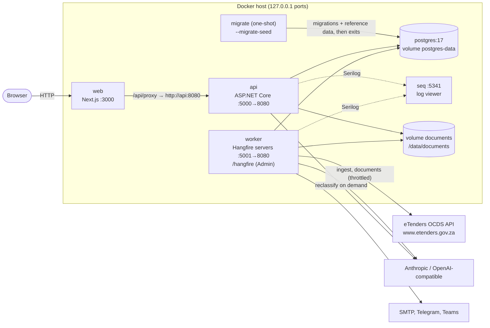
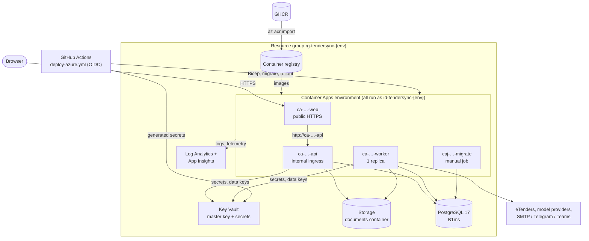
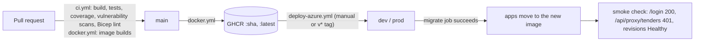

# Deployment diagrams

TenderSync runs the same four images in both places (ADR-0017): `tendersync-api`, `tendersync-worker`,
`tendersync-migrate` and `tendersync-web`. `docker.yml` builds them and publishes them to GHCR on every merge to main.

## Docker Compose (local or a single VPS)

`deploy/docker/docker-compose.yml`; runbook `docs/runbooks/local.md`. Every port binds to `BIND_ADDRESS` (127.0.0.1 by
default), so nothing is reachable from other machines unless you change it or put a TLS proxy in front.

The `api` and `worker` services start only after `migrate` has completed successfully. Secrets come from
`deploy/docker/.env`, which is git-ignored. `docker-compose.override.yml` supplies development placeholders.

## Azure (Container Apps)

`deploy/azure` (Bicep) and `.github/workflows/deploy-azure.yml`; runbook `docs/runbooks/azure.md`.

Only the web app has a public endpoint. Every app and the job run as the managed identity `id-tendersync-{env}`, which
pulls images, resolves Key Vault references, wraps document keys and reads and writes blobs. The managed identity's roles:

| Role | Scope | Allows |
|---|---|---|
| AcrPull | Registry | Pulling images |
| Key Vault Secrets User | Vault | Resolving secret references |
| Key Vault Crypto User | Master key | Wrapping and unwrapping document data keys |
| Storage Blob Data Contributor | Storage account | Reading and writing documents |

The deployer identity has Contributor and Role Based Access Control Administrator on the resource group, plus Key Vault
Secrets Officer on the vault.

## Release flow

