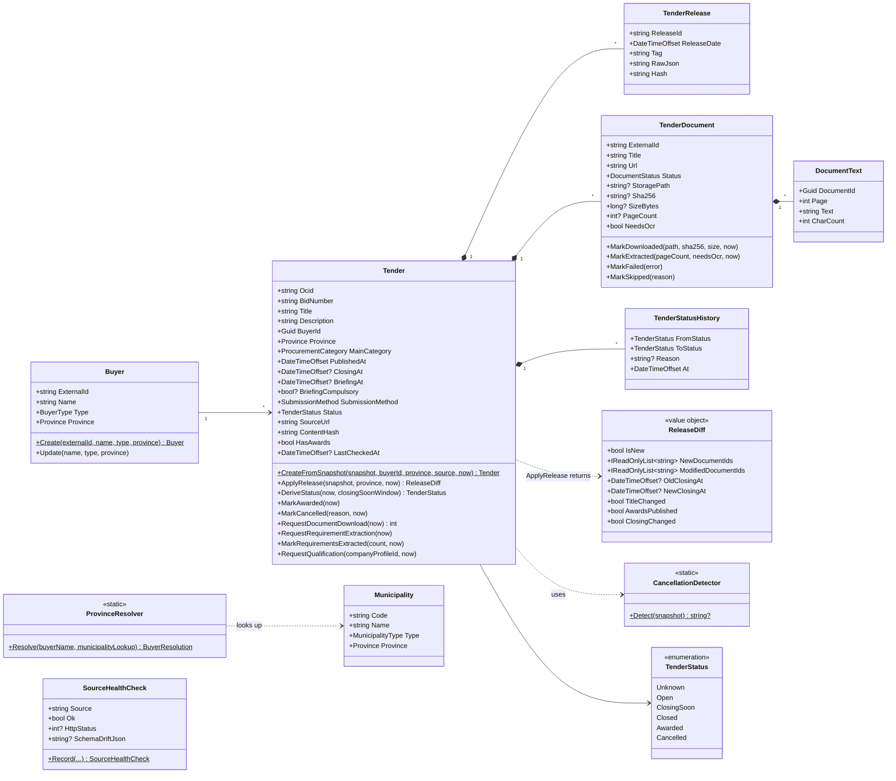
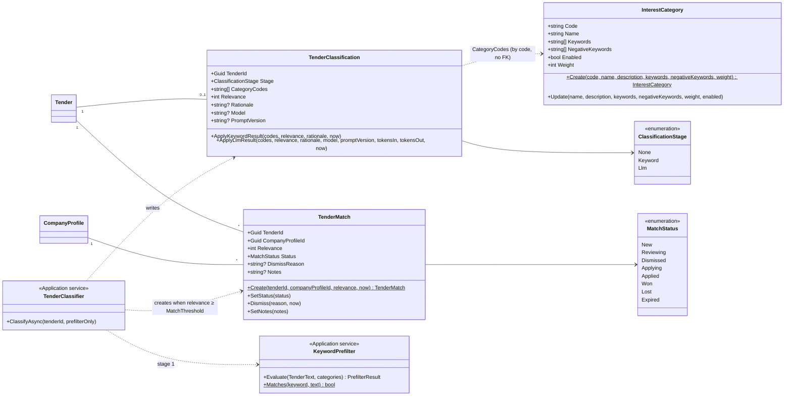
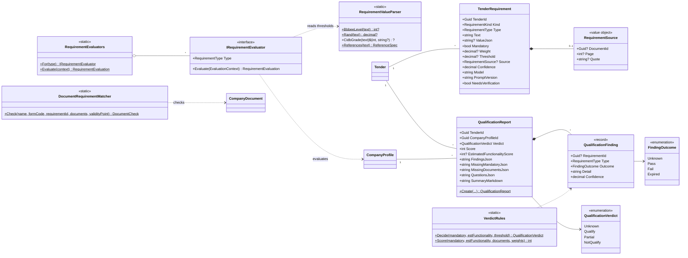
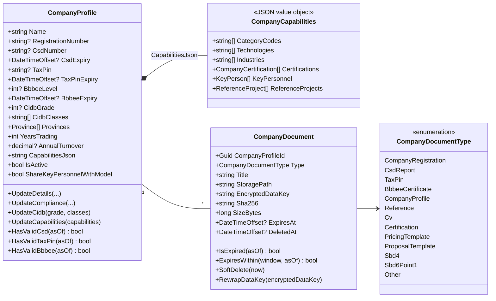
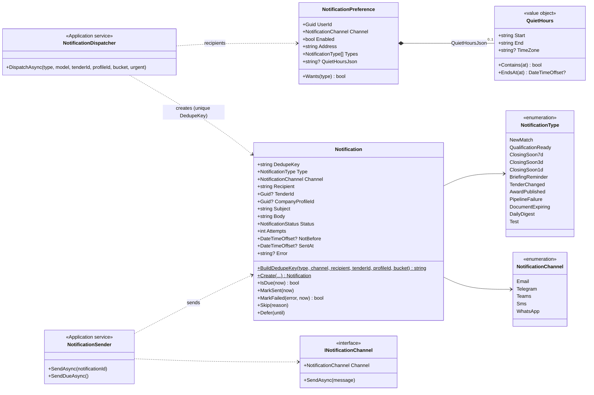
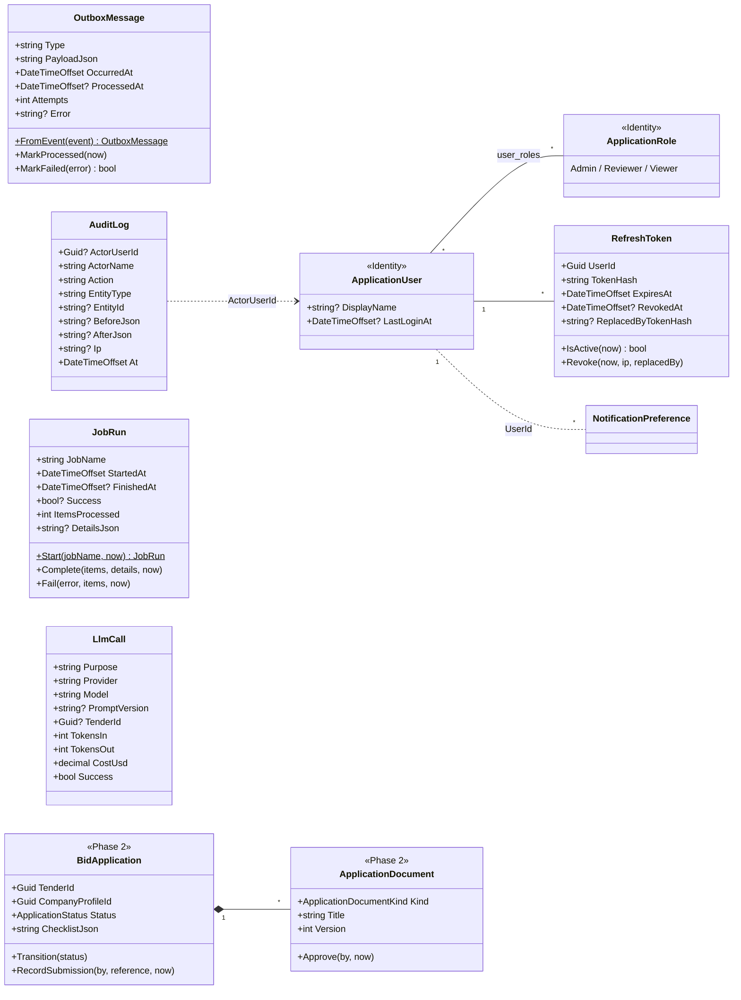

# Domain class diagrams

One diagram per bounded area, drawn from `src/TenderSync.Domain` (and the Identity types in Infrastructure). PLAN.md
§4.5 is the original sketch; where they differ, this page and the code win.

Conventions that apply everywhere:

- **`Entity` is the base type.** Every persisted type except `DocumentText`, `TenderClassification` and the Identity
  types derives from it. `Entity` provides:
  - `Id`, a UUIDv7 generated in the domain.
  - `CreatedAt` and `UpdatedAt` timestamps.
  - Domain events, raised with `Raise(...)`.
- **There is no separate aggregate-root type.** The aggregates are the entities that own child collections, such as
  `Tender`.
- **Events are written in the same transaction.** On `SaveChangesAsync`, `AuditAndOutboxInterceptor` turns raised events
  into `outbox_messages` rows.
- **Setters are private.** State changes only through methods such as `Tender.ApplyRelease` and `TenderMatch.Dismiss`.
- **JSON columns:** properties named `*Json` are jsonb columns with a typed accessor that EF ignores.

- [Tenders and sources](#tenders-and-sources)
- [Classification and matching](#classification-and-matching)
- [Requirements and qualification](#requirements-and-qualification)
- [Company](#company)
- [Notifications](#notifications)
- [Operations and security](#operations-and-security)

## Tenders and sources

Events raised here:

- **`TenderFirstSeen`:** a new OCID.
- **`TenderChanged`:** carries the `ReleaseDiff`.
- **`TenderStatusChanged`:** every transition, recorded in `TenderStatusHistory`. Awarded and Cancelled are sticky.
- **`TenderDocumentsRequested`, `TenderExtractionRequested`, `RequirementsExtracted` and
  `TenderQualificationRequested`:** pipeline hand-offs.
- **`DocumentTextExtracted`:** a document's text is stored.
- **`PipelineFailure`:** raised by `SourceHealthCheck.Record` when a check fails or the schema drifts.

## Classification and matching

`TenderMatch.Create` raises `TenderMatched`. The match's workflow state changes only through `UpdateMatchCommand` (PATCH
`/matches/{id}`), and dismissing needs a reason.

## Requirements and qualification

The evaluators cover CSD, tax compliance, B-BBEE, CIDB, company registration, years in business, minimum turnover,
references and certifications. Insurance, accreditation, local content and joint-venture rules are evaluated as
Unknown, because the profile does not hold them, and become questions. `VerdictRules` decide the outcome:

- Any Fail gives NotQualify.
- Any Unknown or Expired, or an estimate under the threshold, gives Partial.
- Anything else gives Qualify.

The score weights are 60 mandatory, 30 functionality and 10 documents. `QualificationReport.Create` raises
`QualificationCompleted`.

## Company

Company documents are stored as `companies/{profileId}/{documentId}.enc`. Each is a TSE1 file with chunked AES-256-GCM
encryption under a random data key. `EncryptedDataKey` is that data key wrapped by the master key, as
`v1|{keyId}|{base64}`. The tax PIN is `[Sensitive]` on requests and masked in responses. Key personnel go to the model by
role only, and only when `ShareKeyPersonnelWithModel` is on.

## Notifications

A row is `Pending` until it is sent. A failed send retries after 1, 2, 4 and 8 minutes, up to 5 attempts. Channels
that are not configured mark the row `Skipped`. Bid-pack contact details never go into a message (POPIA).

## Operations and security

The tables these types write:

- **`outbox_messages`:** `OutboxMessage`, the hand-off between pipeline stages.
- **`audit_logs`:** `AuditBehaviour` writes a row for every command, with `[Sensitive]` values redacted. Sign-ins and
  company document downloads are recorded too.
- **`job_runs`:** `JobRun`, written for every job run.
- **`llm_calls`:** `LlmCall`, written for every model call, including failed ones. It feeds the daily cost cap and the
  cost chart.
- **`refresh_tokens`:** `RefreshToken` keeps only the token's hash and rotates it on every refresh.

`BidApplication` and `ApplicationDocument` exist for Phase 2. In v1 nothing writes them, and nothing ever submits a bid
(ADR-0015).
