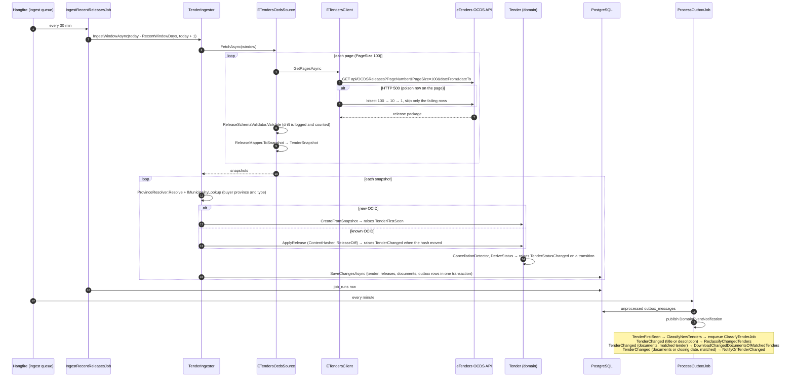
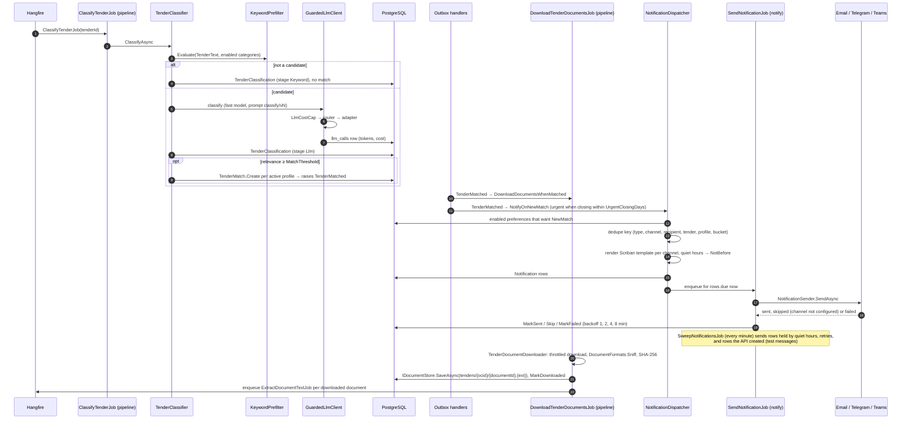
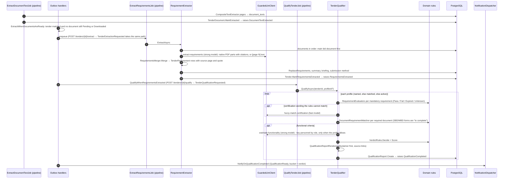
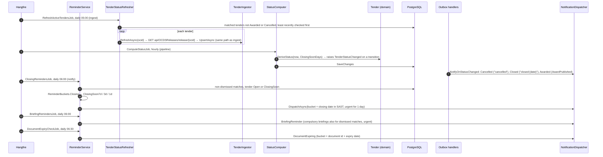

# Sequence diagrams

These diagrams follow the code as of WP18, not the first sketch in PLAN.md §4.4. The main difference is that pipeline
stages do not enqueue each other: each stage saves its result and raises a domain event. The event becomes an
`outbox_messages` row in the same transaction. `ProcessOutboxJob` publishes it, and an event handler enqueues the next
job through `IPipelineScheduler`. All event handlers run in the Worker; the API registers `NoPipelineScheduler`.

Hangfire queues:

- **`ingest`, `notify` and `default`:** the Worker's main server.
- **`pipeline`:** a second server with `Hangfire:PipelineWorkerCount` workers (2 by default). It keeps document and model
  work to a polite concurrency.

Cron times are SAST (`JobSchedule.Register`).

- [Ingest](#ingest)
- [Match to notification](#match-to-notification)
- [Qualification](#qualification)
- [Reminders and status](#reminders-and-status)

## Ingest

`IngestRecentReleasesJob` runs every 30 minutes over a short rolling window. `BackfillReleasesJob` runs the same path
over 90 days in 7-day slices on Sunday at 02:00. Every job body runs inside `JobRunner`, which writes a `job_runs` row.
After three failures in a row, `JobRunner` records an unhealthy `SourceHealthCheck`, which raises `PipelineFailure`.

## Match to notification

## Qualification

The model never decides a hard fact: CSD, tax, B-BBEE, CIDB, turnover, years and references are pure functions over
the profile in `TenderSync.Domain/Qualification`. Every Unknown, Expired, fuzzy match and compulsory briefing becomes a
question for a human in the report.

## Reminders and status

Buckets make the dedupe key: the same fact never notifies twice, a new fact (another reminder day, a new verdict, a
different diff) does. `Notification.dedupe_key` is unique in the database, so a retried outbox batch cannot double-send.
